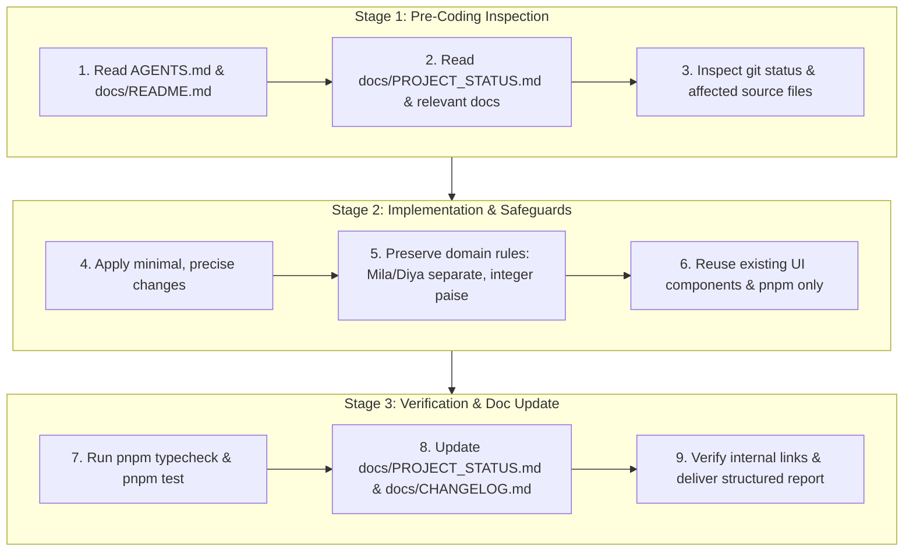

# Permanent AI Coding Agent Workflow Guide — व्यवहार (Vyavahaar)

> **Mandatory Standard**: Every AI agent (Claude, Gemini, Copilot, Cursor, etc.) working on this repository must follow this workflow without exception.

---

## 1. Operating Principles

1. **Investigate Before Editing**: Never assume you know the repository state from your training data or previous chat snippets. Always inspect the actual files first.
2. **Never Break Working Features**: Never replace working architectures, delete user data, or modify working business logic unless explicitly requested.
3. **Continuous Documentation Maintenance**: Every code change must update its corresponding documentation in the same task.
4. **Honesty Over Optimism**: Never mark a task as "VERIFIED" without running actual tests or inspecting code evidence.

---

## 2. The 3-Stage AI Agent Workflow

---

## 3. Pre-Coding Inspection Checklist

Before modifying any file, the AI agent must:
- [ ] Read `AGENTS.md`.
- [ ] Read `docs/README.md` and `docs/PROJECT_STATUS.md`.
- [ ] Check `docs/KNOWN_CONSTRAINTS.md` to ensure the requested task does not violate non-negotiable boundaries.
- [ ] Check `docs/DOMAIN_RULES.md` if touching financial, ledger, or transaction code.
- [ ] Check `docs/DATABASE_SCHEMA.md` if touching database queries or SQLite models.
- [ ] Check `docs/UI_UX_GUIDELINES.md` if modifying or adding UI components.
- [ ] Run `git status` to check existing uncommitted modifications.

---

## 4. Implementation Safeguards Checklist

While writing code, the AI agent must:
- [ ] Make only the requested changes; do not refactor unrelated working files.
- [ ] Maintain 100% offline-first behavior (zero cloud/server calls).
- [ ] Store currency in **integer paise** exclusively.
- [ ] Keep **Mila** and **Diya** strictly separated.
- [ ] Use **vector icons (`Ionicons`) only**; zero emojis in UI.
- [ ] Use package manager **`pnpm`** exclusively. Never install dependencies without explicit user permission.
- [ ] Retain the approved floating pill bottom navigation bar.

---

## 5. Post-Coding Verification & Documentation Checklist

After writing code, the AI agent must:
- [ ] Run `pnpm typecheck` (`tsc --noEmit`) and ensure 0 errors.
- [ ] Run `pnpm test` (`pnpm test:logic && pnpm test:phase3`) and ensure all 27 tests pass.
- [ ] Update `docs/PROJECT_STATUS.md` with verified status changes.
- [ ] Update `docs/CHANGELOG.md` with a summary of changes.
- [ ] Update `docs/FEATURES.md` if feature scope changed.
- [ ] Update `docs/KNOWN_ISSUES.md` if a bug was fixed or discovered.
- [ ] Verify that all internal relative markdown links are valid.

---

## 6. Failure & Discrepancy Reporting Protocol

If an AI agent is unable to complete a task, encounters a test failure, or discovers a mismatch between documentation and code, it must report:
1. **What was inspected**: Exact file paths and line ranges.
2. **What succeeded**: Changes that compiled and verified.
3. **What failed or remains**: Exact error logs, failed test assertions, or unresolved requirements.
4. **Discrepancy Explanation**: Why the contradiction exists and what the intended behavior should be.
5. **Recommended Next Steps**: Explicit options for the user or next agent to proceed safely.
