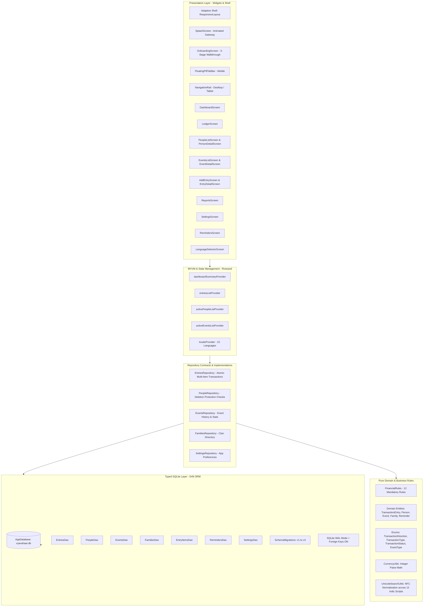

# System Architecture — व्यवहार (Vyavahaar)

> **Official Implementation**: Feature-First, MVVM + Repository Pattern, Typed Drift ORM, Flutter Riverpod  
> **Framework**: **Flutter + Dart (Sole Application Framework)**  
> **Target Scope**: 5 Cross-Platform Operating Systems: **Android, iOS, Linux Desktop, macOS Desktop, Windows Desktop**  
> **Offline Policy**: 100% Offline-First; SQLite is the sole source of truth; zero cloud dependencies.  
> **Branch**: `migration/flutter-only`  
> **Last Updated**: 2026-11-21  

---

## 1. System Architecture Diagram (Flutter + Dart)

The Flutter architecture implements strict layer separation where presentation code never touches raw SQL, and business logic remains 100% independent of UI widgets:

---

## 2. Layer Responsibilities & Strict Isolation

1. **Presentation Layer (`lib/src/features/`, `lib/src/shared/`)**:
   - Contains only Flutter widgets, responsive layouts, and animations.
   - Watches Riverpod providers.
   - **Never executes SQL queries, currency conversions, or business logic**.
   - Uses `ResponsiveLayout` to dynamically provide the approved floating pill bottom bar on mobile (<600dp) and a spacious navigation rail/sidebar on desktop (≥1024dp).
2. **State Layer (`lib/src/app/app_providers.dart`, `lib/src/core/localization/`)**:
   - Manages UI state using Riverpod `FutureProvider`, `StreamProvider`, and `StateNotifier`.
   - Dispatches user intents to repositories and reacts to database stream emissions.
3. **Domain Layer (`lib/src/domain/`)**:
   - Contains pure Dart entity classes and financial calculation rules (`FinancialRules`).
   - Zero dependencies on Flutter UI or Drift database packages.
   - Enforces the 12 non-negotiable cultural ledger rules (separating Mila and Diya, isolating gift valuations, and rejecting invalid transaction combinations).
4. **Repository Layer (`lib/src/data/repositories/`)**:
   - Mediates between the domain entities and the Drift database DAOs.
   - Manages atomic multi-record transactions (e.g. inserting an entry and multiple physical gifts atomically with complete rollback on error).
5. **Data Layer (`lib/src/data/database/`)**:
   - Drift typed tables and DAOs.
   - Direct native C-bindings to SQLite in WAL mode with foreign keys enabled (`PRAGMA foreign_keys = ON;`).

---

## 3. Data Integrity & Financial Consistency

* **Integer Paise Arithmetic**: All financial amounts in the repository and database layers are represented in integer paise (`1 Rupee = 100 Paise`). Floating-point numbers are strictly forbidden.
* **Mila & Diya Separation**: Total Received and Total Given are queried and calculated as independent positive sums. Under no circumstances are they subtracted or netted.
* **Soft Archiving**: Destructive deletions are avoided. People, events, families, and entries support soft archiving via `archived_at` timestamps to preserve historical records.
* **Deletion Protection**: A person with associated transactions cannot be deleted (`ON DELETE RESTRICT` enforced by SQLite engine).

---

## 4. First Launch & Onboarding Persistence Architecture

Vyavahaar maintains a 100% offline-first onboarding lifecycle:
1. **Initial Route**: `appRouter` points to `/splash`.
2. **State Inspection**: `SplashScreen` queries `SettingsRepository.getSetting('onboarding_completed')` from the Drift `settings` table.
3. **Branching Decision**:
   - If `'onboarding_completed' == 'true'`: Navigates to `/` (Home Dashboard).
   - If not set or `null`: Navigates to `/onboarding`.
4. **Completion & Dismissal**: Completing the 3-slide walkthrough or tapping "छोड़ें" (Skip) writes `'onboarding_completed' = 'true'` via `SettingsRepository.setSetting()`, atomically persisting the state to local SQLite.
5. **Re-tour Mechanism**: The onboarding tour can be re-launched from Settings with `?fromSettings=true` without affecting previous user preferences.
