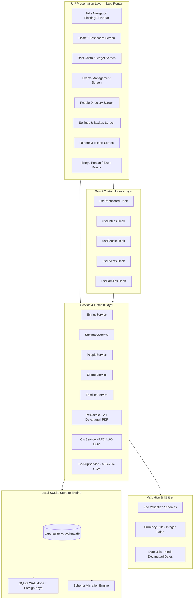
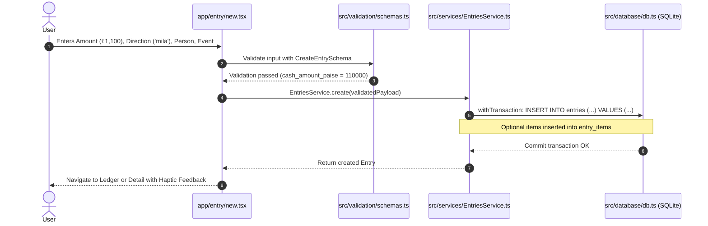

# System Architecture — व्यवहार (Vyavahaar)

> **Architectural Pattern**: Offline-First Cross-Platform Layered Architecture  
> **Target Platforms**: Android, iOS, Linux Desktop, macOS Desktop, Windows Desktop (5 Platforms)  
> **Master Cross-Platform Blueprint**: [`docs/FLUTTER_MIGRATION_ARCHITECTURE.md`](FLUTTER_MIGRATION_ARCHITECTURE.md)  
> **Last Updated**: 2026-11-21

---

## 1. High-Level Architectural Diagram

---

## 2. Layer Responsibilities

### 1. Presentation Layer (`app/`)
- Utilizes **Expo Router** file-based navigation.
- Root layout (`app/_layout.tsx`) initializes database and registers screen transitions.
- Tab navigator (`app/(tabs)/_layout.tsx`) hosts the 5 core tabs with `FloatingPillTabBar`.
- Dynamic stack routes handle creation and detail views:
  - `app/entry/[id].tsx`, `app/entry/new.tsx`
  - `app/event/[id].tsx`, `app/event/new.tsx`
  - `app/person/[id].tsx`, `app/person/new.tsx`
  - `app/reports/index.tsx`

### 2. Custom Hooks Layer (`src/hooks/`)
- Encapsulates database service calls and component lifecycle.
- Provides reactive state (`data`, `loading`, `error`, `refresh`).
- Integrates `useFocusEffect` to automatically trigger data refresh when returning from modals or editing forms.

### 3. Service Layer (`src/services/`)
- **EntriesService**: Handles transaction CRUD, filtering, pagination, and soft deletion (`deleted_at`).
- **SummaryService**: Executes high-speed aggregation queries for Mila/Diya totals, counting, and relationship profiles.
- **PeopleService & FamiliesService**: Manages contacts, relationships, and clan groupings.
- **EventsService**: Manages ceremonial events and event-specific ledgers.
- **PdfService**: Assembles self-contained HTML templates with embedded Noto Sans Devanagari and triggers `expo-print`.
- **CsvService**: Serializes records according to RFC-4180 with UTF-8 Byte Order Mark (`\uFEFF`) for Excel compatibility.
- **BackupService**: Implements atomic database snapshots, PBKDF2 key derivation, AES-256 encryption, and safe rollback restore.

### 4. Database Access Layer (`src/database/db.ts`)
- Manages single SQLite connection `vyavahaar.db` via `expo-sqlite`.
- Enforces `PRAGMA journal_mode = WAL;` (Write-Ahead Logging for high concurrency and zero corruption).
- Enforces `PRAGMA foreign_keys = ON;` (Cascading deletes on household/family, restrict deletes on transactions).
- Runs atomic migrations on startup.
- Exposes `withTransaction<T>(fn: () => T)` for atomic rollbacks during restore and batch operations.

---

## 3. Data Flow Architecture (Transaction Creation Example)

---

## 4. Error Handling & Resilience
- **SQLite Transactions**: Multi-table insertions (such as an entry with multiple gifts) are executed inside `withTransactionSync`. If any sub-item insertion fails, the entire transaction is rolled back immediately.
- **Safe Area Insets**: Handled natively via `react-native-safe-area-context` so elements never overlap system notches, camera cutouts, or bottom gesture navigation bars.
- **Graceful Fallbacks**: If haptics or sharing sheets are unavailable on older Android versions, the operations fail gracefully without interrupting user workflows.

---

## 5. Cross-Platform Layering & Desktop Separation

The cross-platform architecture enforces a strict boundary between shared logic and platform-specific UI:

1. **Shared Core (100% Platform-Agnostic)**:
   - Pure domain models (`Household`, `Person`, `Event`, `Entry`, `EntryItem`).
   - Currency calculations in integer paise (`rupeesToPaise`, `formatCurrency`).
   - Business rules (Mila/Diya separation, exclusion of planned/cancelled entries, exclusion of gift estimates).
   - Validation logic (Zod / Dart equivalent schemas).
   - Cryptographic backup envelope v3 (AES-256-GCM, PBKDF2, HMAC).

2. **Platform-Adaptive UI Layer**:
   - **Mobile (Android & iOS)**: Touch-first, swipe dismissals, floating pill bottom navigation, compact vertical cards.
   - **Desktop (Linux, macOS, Windows)**: Collapsible sidebar navigation, wide data tables, resizable windows (min 960x600), keyboard shortcuts (`Ctrl+N` / `Cmd+N`, `Ctrl+F`), and mouse hover states.

3. **Platform Services & Adapters**:
   - File system persistence, native file pickers, secure hardware keystores, and sharing sheets are abstracted behind unified platform adapter interfaces.
   - For complete Flutter & Drift architectural blueprints, see [`docs/FLUTTER_MIGRATION_ARCHITECTURE.md`](FLUTTER_MIGRATION_ARCHITECTURE.md).
