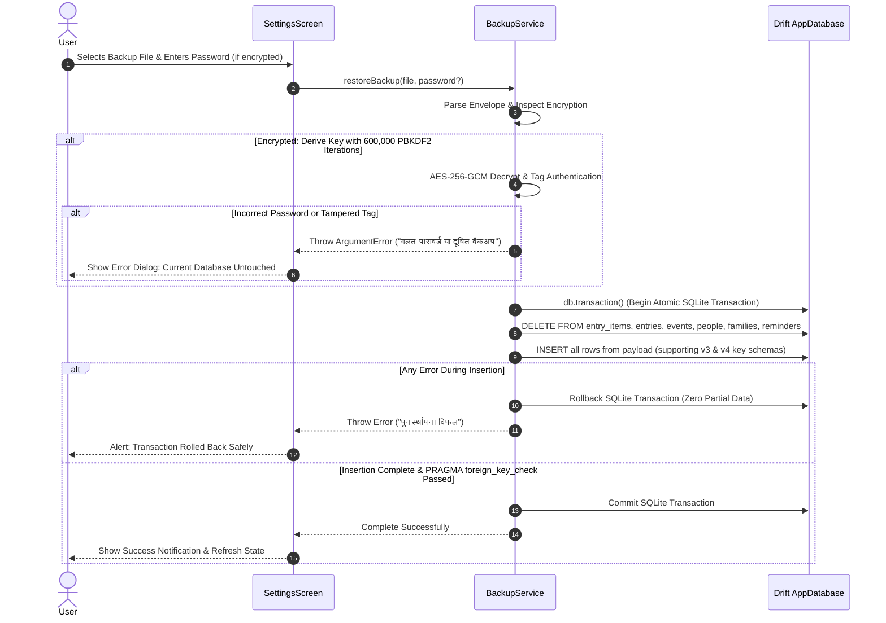

# Backup & Restore Architecture — व्यवहार (Vyavahaar)

> **Implementation**: `lib/src/features/settings/services/backup_service.dart`  
> **UI Entry Point**: `lib/src/features/settings/presentation/settings_screen.dart` (`/settings`)  
> **Format Version**: v4 (`vyavahaar_backup_version: 4`) with backward compatibility for v3  
> **Cryptographic Standard**: AES-256-GCM + PBKDF2-HMAC-SHA256 (600,000 iterations, OWASP-aligned)  
> **Sole Application Framework**: Flutter + Dart  
> **Last Updated**: 2026-11-21  

---

## 1. Backup File Format Specification

Backups are exported as standardized, self-describing `.json` files. They exist in two formats: **Plain JSON** (for personal device storage) and **AES-256-GCM Encrypted JSON** (for sharing via email, WhatsApp, or Drive).

### 1.1 Plain Backup Envelope (v4)
```json
{
  "vyavahaar_backup_version": 4,
  "app_version": "1.0.0",
  "created_at": "2026-11-21T03:00:00.000Z",
  "is_encrypted": false,
  "metadata": {
    "vyavahaar_backup_version": 4,
    "app_version": "1.0.0",
    "created_at": "2026-11-21T03:00:00.000Z",
    "is_encrypted": false,
    "people_count": 14,
    "events_count": 5,
    "entries_count": 28,
    "items_count": 8
  },
  "payload": {
    "families": [ ... ],
    "people": [ ... ],
    "events": [ ... ],
    "entries": [ ... ],
    "entry_items": [ ... ],
    "reminders": [ ... ]
  }
}
```

### 1.2 Encrypted Backup Envelope (v4)
When password protection is enabled, the `payload` is encrypted using authenticated AES-256-GCM:
```json
{
  "vyavahaar_backup_version": 4,
  "app_version": "1.0.0",
  "created_at": "2026-11-21T03:00:00.000Z",
  "is_encrypted": true,
  "metadata": {
    "vyavahaar_backup_version": 4,
    "app_version": "1.0.0",
    "created_at": "2026-11-21T03:00:00.000Z",
    "is_encrypted": true,
    "people_count": 14,
    "events_count": 5,
    "entries_count": 28,
    "items_count": 8
  },
  "kdf": {
    "algorithm": "PBKDF2-HMAC-SHA256",
    "iterations": 600000,
    "salt": "<base64-encoded-16-byte-salt>"
  },
  "cipher": {
    "algorithm": "AES-256-GCM",
    "nonce": "<base64-encoded-12-byte-nonce>",
    "tag": "<base64-encoded-16-byte-auth-tag>",
    "ciphertext": "<base64-encoded-ciphertext>"
  }
}
```

---

## 2. Backup Generation Process

1. **Extraction**: `BackupService` queries the active SQLite database tables (`families`, `people`, `events`, `entries`, `entry_items`, `reminders`).
2. **Metadata Summary**: Entity counts and timestamps are calculated for user visibility.
3. **Encryption (If Password Provided)**:
   - Cryptographically secure 128-bit (16-byte) salt generated via `Random.secure()`.
   - Cryptographically secure 96-bit (12-byte) nonce generated via `Random.secure()`.
   - PBKDF2-HMAC-SHA256 derives 256-bit encryption key with **600,000 iterations** (OWASP password storage recommendation).
   - Payload encrypted with authenticated **AES-256-GCM** generating ciphertext and 128-bit authentication tag.
4. **File Output**: Written to the application's document directory:
   - Plain format: `vyavahaar_backup_<timestamp>.json`
   - Encrypted format: `vyavahaar_backup_<timestamp>.enc.json`
5. **Native Share Sheet**: Invokes `Share.shareXFiles()` via `share_plus` allowing the user to store the backup locally, send via email, or copy to cloud drives.

---

## 3. Safe Restore Architecture & Atomic Rollback

Restoring data is a safety-critical operation:



---

## 4. Backward Compatibility

The restore engine supports both:
1. **Envelope v4**: Snake_case keys (`full_name`, `amount_paise`, `transaction_date`, `is_completed`).
2. **Legacy Envelope v3**: CamelCase keys (`name`, `cashAmountPaise`, `village`, `deleted_at`).
Existing backups created prior to the migration can be safely restored without data loss.
