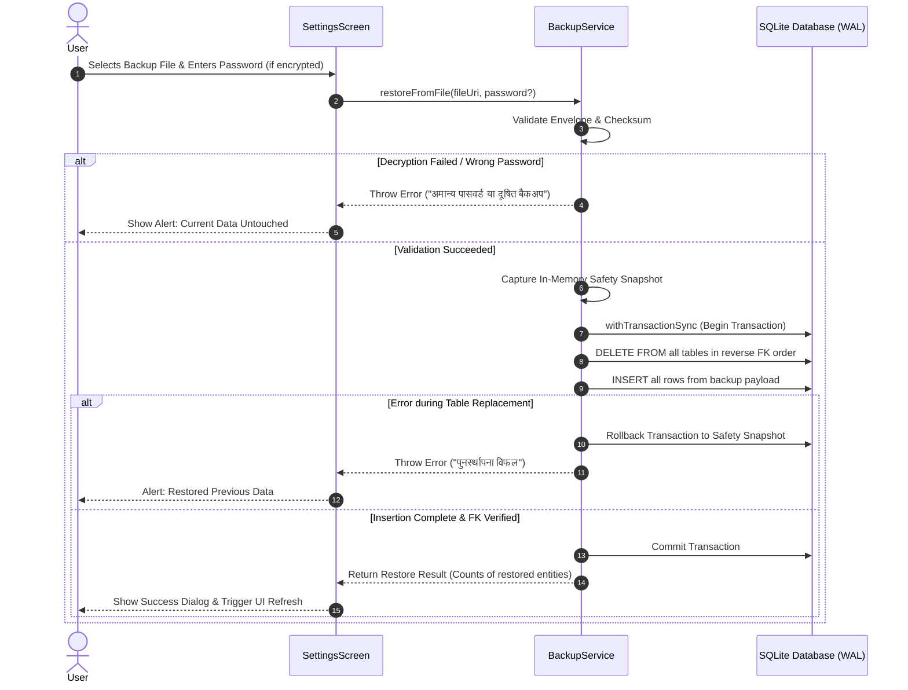

# Backup & Restore Architecture — व्यवहार (Vyavahaar)

> **Implementation**: `src/services/BackupService.ts`  
> **UI Entry Point**: `app/(tabs)/settings.tsx`  
> **Format Version**: v3 (`vyavahaar_backup_version: 3`)  
> **Last Updated**: 2026-11-21

---

## 1. Backup File Format Specification

Backups are exported as standardized, self-describing `.json` files. They exist in two formats: **Plain JSON** (for personal device storage) and **AES-256 Encrypted JSON** (for sharing via WhatsApp or Drive).

### 1.1 Plain Backup Envelope
```json
{
  "vyavahaar_backup_version": 3,
  "app_version": "1.0.0",
  "created_at": "2026-11-21T03:00:00.000Z",
  "is_encrypted": false,
  "checksum": "sha256_hash_of_payload",
  "metadata": {
    "vyavahaar_backup_version": 3,
    "app_version": "1.0.0",
    "created_at": "2026-11-21T03:00:00.000Z",
    "is_encrypted": false,
    "people_count": 14,
    "families_count": 3,
    "events_count": 5,
    "entries_count": 28,
    "items_count": 8,
    "reminders_count": 2
  },
  "payload": {
    "households": [ ... ],
    "families": [ ... ],
    "people": [ ... ],
    "events": [ ... ],
    "entries": [ ... ],
    "entry_items": [ ... ],
    "reminders": [ ... ]
  }
}
```

### 1.2 Encrypted Backup Envelope
When password protection is enabled, the `payload` is encrypted and replaced with cryptographic parameters:
```json
{
  "vyavahaar_backup_version": 3,
  "app_version": "1.0.0",
  "created_at": "2026-11-21T03:00:00.000Z",
  "is_encrypted": true,
  "salt": "a1f9e8... (hex)",
  "iv": "3d9c81... (hex)",
  "ciphertext": "U2FsdGVkX1...",
  "hmac": "98a7bc... (hex)",
  "metadata": {
    "vyavahaar_backup_version": 3,
    "app_version": "1.0.0",
    "created_at": "2026-11-21T03:00:00.000Z",
    "is_encrypted": true,
    "people_count": 14,
    "families_count": 3,
    "events_count": 5,
    "entries_count": 28,
    "items_count": 8,
    "reminders_count": 2
  }
}
```

---

## 2. Backup Generation Process

1. **Extraction**: `BackupService.dumpDatabaseToPayload()` queries all 7 SQLite tables (`households`, `families`, `people`, `events`, `entries`, `entry_items`, `reminders`).
2. **Metadata Summary**: Counts and timestamps are calculated for user visibility.
3. **Encryption (If Requested)**:
   - Unique 128-bit salt and 128-bit IV generated via `CryptoJS.lib.WordArray.random(16)`.
   - PBKDF2 derives key from user password + salt (`10,000` iterations, 256-bit key size).
   - Payload encrypted with AES-256-CBC.
   - HMAC-SHA256 checksum calculated over ciphertext.
4. **File Persistence**: Written to app-private cache directory:
   - Plain format: `vyavahaar_backup_YYYY-MM-DD_HH-mm-ss.json`
   - Encrypted format: `vyavahaar_encrypted_backup_YYYY-MM-DD_HH-mm-ss.json`
5. **Native Share Sheet**: Invokes `Sharing.shareAsync()` so the user can send the file to Google Drive, WhatsApp, Email, or save to local storage.

---

## 3. Safe Restore Architecture

Restoring data is a critical operation. The system employs a multi-tiered safety strategy:



---

## 4. Test Verification Evidence

The backup and restore system is continuously tested in `scripts/test-phase3-features.ts`:
- **Test 2.1**: Encrypted backup generates unique salt and IV for every single run (`PASSED`).
- **Test 2.2**: Decryption succeeds with correct password and restores exact byte-for-byte payload (`PASSED`).
- **Test 2.3**: Decryption fails cleanly and is rejected when given an incorrect password (`PASSED`).
- **Test 2.4**: Tampered or truncated ciphertext is detected by HMAC and rejected (`PASSED`).
- **Test 3.1**: Safety snapshot captures complete state before modification (`PASSED`).
- **Test 3.2**: Atomic rollback restores original database state on simulated restore failure (`PASSED`).
