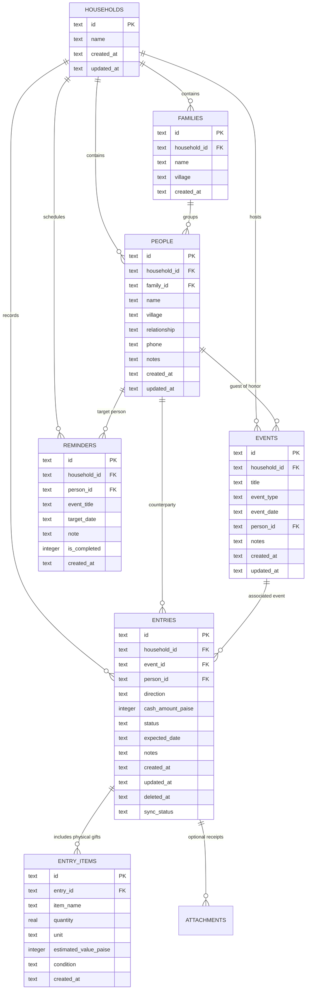

# Database Schema & Migrations — व्यवहार (Vyavahaar)

> **Database Engine**: SQLite via `expo-sqlite` (Synchronous API)  
> **Database File**: `vyavahaar.db`  
> **Configuration**: `PRAGMA journal_mode = WAL;`, `PRAGMA foreign_keys = ON;`  
> **Current Schema Version**: v3 (Entries with `status` and `expected_date`)  
> **Last Updated**: 2026-11-21

---

## 1. Core Financial Principle: Integer Paise

All currency values in the database are stored as **INTEGER PAISE**, never floating-point rupees.
- ₹1.00 = `100` paise
- ₹100.00 = `10000` paise
- ₹1,100.00 = `110000` paise
- ₹51,000.00 = `5100000` paise

*Rationale*: Floating-point numbers (`REAL` in SQLite) introduce rounding errors over time (e.g. `0.1 + 0.2 = 0.30000000000000004`). In traditional Indian ledger accounting, exact rupee amounts are sacred.

---

## 2. Entity Relationship Diagram (ERD)



---

## 3. Table Specifications

### 3.1 `households` (Family Identity)
Primary root unit representing the user's family ledger.
- `id` (TEXT, PK, NOT NULL): Unique identifier (`household_primary_01`).
- `name` (TEXT, NOT NULL): Household name (e.g., "हमारा परिवार").
- `created_at` (TEXT, NOT NULL, DEFAULT `(datetime('now'))`): Creation timestamp.
- `updated_at` (TEXT, NOT NULL, DEFAULT `(datetime('now'))`): Modification timestamp.

### 3.2 `families` (Clan / Extended Family Units)
- `id` (TEXT, PK, NOT NULL): UUID string.
- `household_id` (TEXT, NOT NULL, FK → `households.id` ON DELETE CASCADE).
- `name` (TEXT, NOT NULL): Family name (e.g., "वर्मा परिवार", "चौधरी खानदान").
- `village` (TEXT, NULLABLE): Village, town, or city.
- `created_at` (TEXT, NOT NULL, DEFAULT `(datetime('now'))`).

### 3.3 `people` (Contacts / Counterparties)
- `id` (TEXT, PK, NOT NULL): UUID string.
- `household_id` (TEXT, NOT NULL, FK → `households.id` ON DELETE CASCADE).
- `family_id` (TEXT, NULLABLE, FK → `families.id` ON DELETE SET NULL).
- `name` (TEXT, NOT NULL): Relative or guest full name.
- `village` (TEXT, NULLABLE): Village or city of residence.
- `relationship` (TEXT, NULLABLE): Cultural relation (e.g., "मामा", "फूफा जी", "चाचा जी", "मित्र").
- `phone` (TEXT, NULLABLE): Contact phone number.
- `notes` (TEXT, NULLABLE): General notes.
- `created_at` (TEXT, NOT NULL, DEFAULT `(datetime('now'))`).
- `updated_at` (TEXT, NOT NULL, DEFAULT `(datetime('now'))`).

### 3.4 `events` (Ceremonies & Functions)
- `id` (TEXT, PK, NOT NULL): UUID string.
- `household_id` (TEXT, NOT NULL, FK → `households.id` ON DELETE CASCADE).
- `title` (TEXT, NOT NULL): Event name (e.g., "अमित की शादी", "आराध्या का मुंडन").
- `event_type` (TEXT, NOT NULL): Event type (`'शादी' | 'तिलक' | 'मुंडन' | 'बरात' | 'सगाई' | 'वर्षगांठ' | 'गृह प्रवेश' | 'अन्य'`).
- `event_date` (TEXT, NOT NULL): Event date in ISO format (`YYYY-MM-DD`).
- `person_id` (TEXT, NULLABLE, FK → `people.id` ON DELETE SET NULL): Primary guest of honor.
- `notes` (TEXT, NULLABLE): Event location or description.
- `created_at` (TEXT, NOT NULL, DEFAULT `(datetime('now'))`).
- `updated_at` (TEXT, NOT NULL, DEFAULT `(datetime('now'))`).

### 3.5 `entries` (Transactions / व्यवहार)
- `id` (TEXT, PK, NOT NULL): UUID string.
- `household_id` (TEXT, NOT NULL, FK → `households.id` ON DELETE CASCADE).
- `event_id` (TEXT, NOT NULL, FK → `events.id` ON DELETE CASCADE).
- `person_id` (TEXT, NOT NULL, FK → `people.id` ON DELETE RESTRICT): Prevents accidental deletion of people who have transaction history.
- `direction` (TEXT, NOT NULL): `'mila'` (received) or `'diya'` (given).
- `cash_amount_paise` (INTEGER, NOT NULL, DEFAULT 0): Amount in integer paise.
- `status` (TEXT, NOT NULL, DEFAULT `'recorded'`): `'planned' | 'recorded' | 'cancelled'`.
- `expected_date` (TEXT, NULLABLE): Expected date for planned entries (`YYYY-MM-DD`).
- `notes` (TEXT, NULLABLE): Transaction remarks.
- `created_at` (TEXT, NOT NULL, DEFAULT `(datetime('now'))`).
- `updated_at` (TEXT, NOT NULL, DEFAULT `(datetime('now'))`).
- `deleted_at` (TEXT, NULLABLE): Soft-delete timestamp.
- `sync_status` (TEXT, NOT NULL, DEFAULT `'local'`).

### 3.6 `entry_items` (Physical Gifts & Items)
- `id` (TEXT, PK, NOT NULL): UUID string.
- `entry_id` (TEXT, NOT NULL, FK → `entries.id` ON DELETE CASCADE).
- `item_name` (TEXT, NOT NULL): Physical item description (e.g. "चाँदी का सिक्का", "कपड़े का सेट").
- `quantity` (REAL, NOT NULL, DEFAULT 1.0).
- `unit` (TEXT, DEFAULT `'संख्या'`): Unit of measure (`'संख्या' | 'सेट' | 'किलो' | 'ग्राम' | 'थान'`).
- `estimated_value_paise` (INTEGER, NULLABLE): Optional estimated valuation in integer paise (strictly excluded from cash totals).
- `condition` (TEXT, NULLABLE).
- `created_at` (TEXT, NOT NULL, DEFAULT `(datetime('now'))`).

### 3.7 `reminders` (Upcoming Event Follow-ups)
- `id` (TEXT, PK, NOT NULL): UUID string.
- `household_id` (TEXT, NOT NULL, FK → `households.id` ON DELETE CASCADE).
- `person_id` (TEXT, NOT NULL, FK → `people.id` ON DELETE CASCADE).
- `event_title` (TEXT, NOT NULL).
- `target_date` (TEXT, NOT NULL): Target date (`YYYY-MM-DD`).
- `note` (TEXT, NULLABLE).
- `is_completed` (INTEGER, NOT NULL, DEFAULT 0): `0` for pending, `1` for completed.
- `created_at` (TEXT, NOT NULL, DEFAULT `(datetime('now'))`).

---

## 4. Performance Indexes

The following indexes ensure that searching tens of thousands of records executes in under 30 milliseconds:

```sql
CREATE INDEX IF NOT EXISTS idx_entries_event ON entries(event_id);
CREATE INDEX IF NOT EXISTS idx_entries_person ON entries(person_id);
CREATE INDEX IF NOT EXISTS idx_entries_direction ON entries(direction);
CREATE INDEX IF NOT EXISTS idx_entries_status ON entries(status);
CREATE INDEX IF NOT EXISTS idx_people_name ON people(name);
CREATE INDEX IF NOT EXISTS idx_people_village ON people(village);
CREATE INDEX IF NOT EXISTS idx_entry_items_entry ON entry_items(entry_id);
```

---

## 5. Migration Strategy

Migrations are executed automatically in `initDatabase()` on application startup:
1. `PRAGMA table_info(entries)` is queried to inspect active columns.
2. If `status` column is absent, it is added via `ALTER TABLE entries ADD COLUMN status TEXT NOT NULL DEFAULT 'recorded'`.
3. If `expected_date` is absent, it is added via `ALTER TABLE entries ADD COLUMN expected_date TEXT`.
4. Schema version is maintained in `BackupMetadata.vyavahaar_backup_version = 3`.

---

## 6. Cross-Platform SQLite & Drift ORM Parity

To ensure that the database file `vyavahaar.db` is 100% binary-portable across **Android, iOS, Linux, macOS, and Windows**:
1. All table schemas, foreign key definitions, and constraints are mirrored directly in Drift ORM (`docs/FLUTTER_MIGRATION_ARCHITECTURE.md`).
2. An existing `vyavahaar.db` file created on Android can be opened, read, and modified directly by desktop runners using standard SQLite WAL mode.
3. Integer paise representation ensures that 64-bit integer amounts match across all platforms and CPU architectures (`arm64`, `x86_64`).
