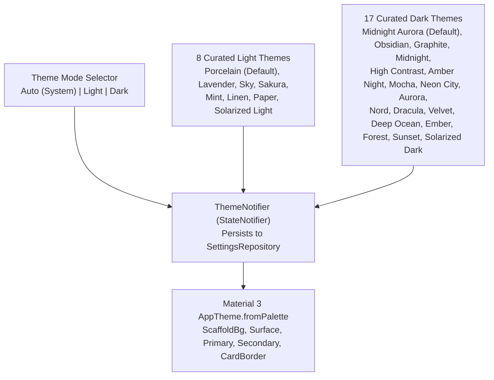

# Design System & Token Specifications — व्यवहार (Vyavahaar)

> **Document Version**: 4.0  
> **Source Files**: `lib/src/core/theme/theme_palette.dart`, `lib/src/core/theme/theme_notifier.dart`, `lib/src/shared/widgets/express_squish.dart`, `lib/src/app/theme/app_theme.dart`  
> **Sole Application Framework**: Flutter + Material 3  
> **Last Updated**: 2026-11-22

---

## 1. Dynamic Theme Architecture & Curated Palettes

Vyavahaar features a full-featured dynamic theme system inspired by `InlitX/streak` with 3 Theme Modes (`Auto (System)`, `Light`, `Dark`), 8 curated Light themes, and 17 curated Dark themes.

### 1.1 Curated Light Palettes (8 Themes)
1. **Porcelain (व्यवहार क्लासिक)**: Warm Cream `#F4EFE7`, Surface `#FFFFFF`, Primary Terracotta `#C05A2B`, Secondary Navy `#1F3352`.
2. **Lavender (लैवेंडर)**: `#F5F3FF`, Surface `#FFFFFF`, Primary `#7C3AED`, Secondary `#4C1D95`.
3. **Sky (आसमानी)**: `#F0F9FF`, Surface `#FFFFFF`, Primary `#0284C7`, Secondary `#0C4A6E`.
4. **Sakura (साकुरा)**: `#FFF1F2`, Surface `#FFFFFF`, Primary `#E11D48`, Secondary `#881337`.
5. **Mint (पुदीना)**: `#F0FDF4`, Surface `#FFFFFF`, Primary `#059669`, Secondary `#064E3B`.
6. **Linen (खादी/लिनन)**: `#FDFBF7`, Surface `#FFFFFF`, Primary `#B45309`, Secondary `#78350F`.
7. **Paper (कागज़)**: `#FAF8F5`, Surface `#FFFFFF`, Primary `#854D0E`, Secondary `#422006`.
8. **Solarized Light**: `#FDF6E3`, Surface `#EEE8D5`, Primary `#268BD2`, Secondary `#073642`.

### 1.2 Curated Dark Palettes (17 Themes)
1. **Midnight Aurora (मिडनाइट ऑरोरा - Default Dark)**: `#0F172A`, Surface `#1E293B`, Primary `#A78BFA`, Secondary `#C084FC`.
2. **Obsidian (ऑब्सिडियन)**: `#09090B`, Surface `#18181B`, Primary `#38BDF8`, Secondary `#0284C7`.
3. **Graphite (ग्रेफाइट)**: `#121417`, Surface `#1E2229`, Primary `#34D399`, Secondary `#059669`.
4. **Midnight (मिडनाइट)**: `#050B14`, Surface `#0B1728`, Primary `#38BDF8`, Secondary `#818CF8`.
5. **High Contrast (हाई कंट्रास्ट)**: `#000000`, Surface `#121212`, Primary `#FACC15`, Secondary `#FFFFFF`.
6. **Amber Night (एम्बर नाइट)**: `#18130C`, Surface `#261D12`, Primary `#F59E0B`, Secondary `#D97706`.
7. **Mocha (मोका)**: `#1E1E2E`, Surface `#313244`, Primary `#CBA6F7`, Secondary `#F38BA8`.
8. **Neon City (नियॉन सिटी)**: `#0D0221`, Surface `#1A0B36`, Primary `#22D3EE`, Secondary `#E879F9`.
9. **Aurora (ऑरोरा)**: `#06181C`, Surface `#0F292F`, Primary `#10B981`, Secondary `#2DD4BF`.
10. **Nord (नॉर्ड)**: `#2E3440`, Surface `#3B4252`, Primary `#88C0D0`, Secondary `#81A1C1`.
11. **Dracula (ड्रेकुला)**: `#282A36`, Surface `#383A59`, Primary `#BD93F9`, Secondary `#FF79C6`.
12. **Velvet (वेलवेट)**: `#180C17`, Surface `#281426`, Primary `#F472B6`, Secondary `#A855F7`.
13. **Deep Ocean (डीप ओशन)**: `#050F1A`, Surface `#0C1E33`, Primary `#38BDF8`, Secondary `#0284C7`.
14. **Ember (एम्बर)**: `#140C08`, Surface `#24160F`, Primary `#F97316`, Secondary `#EA580C`.
15. **Forest (वन)**: `#051B14`, Surface `#0A2E23`, Primary `#34D399`, Secondary `#059669`.
16. **Sunset (सूर्यास्त)**: `#1A0E1A`, Surface `#2D162B`, Primary `#FB7185`, Secondary `#F43F5E`.
17. **Solarized Dark**: `#00212B`, Surface `#002B36`, Primary `#268BD2`, Secondary `#2AA198`.

---

## 2. InlitX/streak Motion & Tactile Tokens

Vyavahaar incorporates fluid spring physics and tactile scale gestures directly adapted from `InlitX/streak`:

### 2.1 ExpressSpring & Motion Constants
- **`ExpressSpring`**: Physics-based damped harmonic oscillator using Flutter's `SpringSimulation.withDampingRatio`:
  - `stiffness`: `380`
  - `dampingRatio`: `0.58`
  - `duration`: `0.52s`
- **Curves**:
  - `Express.bouncy`: Spring simulation curve on touch release.
  - `Express.settle`: `Curves.easeOutCubic` on touch down.
- **Durations**:
  - `Express.fast`: `160ms`
  - `Express.quick`: `280ms`
  - `Express.normal`: `450ms`

### 2.2 ExpressSquish Widget
- Animates scale down to `0.95`–`0.97` on tap down and springs back with bounce on release.
- Applied across buttons, tab items, theme selection cards, and transaction list items.

### 2.3 ExpressCard Widget
- Container with hairline borders (`1px BorderSide`), rounded corners (`16dp` to `20dp`), dynamic dark/light surface colors, and optional tap squish.

---

## 3. Financial Isolation Semantic Palette
- **Mila (Received / मिला)**: `#15803D` / `#209B68` (Light soft bg: `#E2F5EB`, Dark soft bg: `#1B3D27`).
- **Diya (Given / दिया)**: `#B91C1C` / `#DC2626` (Light soft bg: `#FCE9E7`, Dark soft bg: `#451E22`).
- **Planned Status**: `#D97706` (Soft bg: `#FEF3C7` / `#3B2912`).
- Strict rule: Mila and Diya amounts are **never netted** against each other.

---

## 4. Spacing Scale
- `AppSpacing.xs`: `4dp`
- `AppSpacing.sm`: `8dp`
- `AppSpacing.md`: `16dp`
- `AppSpacing.lg`: `20dp`
- `AppSpacing.xl`: `24dp`
- `AppSpacing.floatingTabBottomPadding`: `95dp` (ensures content is never obscured by the floating navigation pill).

---

## 5. Brand Identity, Logo, Splash & Onboarding Specifications

### 5.1 Official Brand Symbol Geometry & `AppSymbol`
- **Concept**: Open Ledger (पारंपरिक बही) + Integrated Verified Checkmark (✓).
- **Implementation**: Pure Flutter vector `VyavahaarSymbolPainter` (zero external dependencies) with fallback to `assets/brand/vyavahaar-symbol-48.png` and `vyavahaar-icon-512.png`.
- **Anatomy**:
  - Left Page Base: Warm Cream (`#F4EFE7`)
  - Left Page Accent Layer: Terracotta (`#C05A2B`)
  - Right Page Base: Warm Cream (`#F4EFE7`)
  - Spine Crease: Deep Navy (`#1F3352`, opacity 0.3)
  - Integrated Checkmark: Terracotta (`#C05A2B`)

### 5.2 App Logo Lockups (`AppLogo`)
- **`AppLogoVariant.vertical`**: Hero stack used in Splash and Onboarding. Circular elevated symbol card (`BorderRadius.circular(circle)`), Devanagari wordmark "व्यवहार" in 36pt extra-bold, and pill-wrapped cultural tagline "रिश्तों का हिसाब, हमेशा याद।".
- **`AppLogoVariant.horizontal` / `compactHeader`**: Used in Dashboard header and top app bars. Symbol icon badge alongside horizontal typography.
- **`AppLogoVariant.symbolOnly`**: Isolated vector mark for avatars and compact chips.
- **Theming**: Supports `AppLogoTheme.darkCanvas` (for Deep Navy canvases) and `AppLogoTheme.lightCanvas` (for Warm Cream / white backgrounds).

### 5.3 Splash Screen Design Specs
- **Canvas**: Fullscreen Deep Navy (`#1F3352`) background with subtle radial gradient aura (`#2A436D` to `#1F3352`).
- **Motion**: 1200ms `AnimationController` with smooth fade (`Curves.easeIn`) and subtle spring scale (`0.88` to `1.0` via `Curves.easeOutBack`).
- **Trust Badge**: Floating pill container (`#1AF4EFE7`) with `Icons.verified_user_outlined` and "100% ऑफ़लाइन और सुरक्षित".
- **Timing & Transitions**: Graceful 1.8-second minimum display; automatically transitions to `/onboarding` (first launch) or `/` (returning user).

### 5.4 Onboarding Screen Design Specs
- **Layout**: Top app bar with `AppSymbol` + "व्यवहार" title on left, tactile "छोड़ें" (Skip) pill on right; middle responsive `PageView`; bottom navigation bar with animated pill dots indicator and tactile `ExpressSquish` CTA.
- **Slides**:
  1. *Slide 1 (Digital Bahi Khata)*: Blue-tinted book icon container (`#EBF3FC`), Mila/Diya separation badge, cash & physical gifts highlight points.
  2. *Slide 2 (Cultural Dignity & Zero Debt)*: Terracotta-tinted goodwill icon (`#FBECE5`), mutual respect badge, budget planning highlight points.
  3. *Slide 3 (100% Offline & Private)*: Green-tinted security shield (`#E2F5EB`), zero internet/zero login badge, AES-256 encryption highlight points, and quick language switch chip.
- **Colors & Cards**: Cards with `cardBg` (`Colors.white` / `#1E293B`), subtle border (`#E2E8F0` / `#334155`), and elevated shadow. CTA button transitions from Deep Navy (`#1F3352`) to Terracotta (`#C05A2B`) on the final slide ("शुरू करें").

---

## 6. InlitX/streak UI/UX Buttons, Typography Scale & PC Desktop Rail

### 6.1 ExpressButton & ExpressIconButton Architecture
- **Source**: `lib/src/shared/widgets/express_button.dart`
- **Visual Tones**:
  - `ExpressTone.filled`: High-contrast solid accent canvas (Terracotta / Deep Navy) with white text and elevation.
  - `ExpressTone.tonal`: Subtle tinted container (12%–22% opacity) with colored text.
  - `ExpressTone.ghost`: Transparent background with border, ideal for secondary modal actions and filters.
- **Dynamic Tactile Physics**:
  - Scale down to `0.94` on tap down, springing back to `1.0` on release using `Express.bouncy` (`ratio: 0.58, stiffness: 380`).
  - **Morphing Border Radius**: Rest at full pill shape (`height / 2`), morphing smoothly into rounded squircle (`14dp` to `16dp`) on press.
  - Heights: Compact (`40dp`, horizontal pad `16dp`, label `13.5sp`) vs Regular (`52dp`, horizontal pad `22dp`, label `15sp`).
- **`ExpressIconButton`**: 40dp squircle icon button with mouse hover highlight and bouncy tap scale.

### 6.2 ExpressType Typography Scale (Streak-Aligned with Poppins & Figtree)
- **Source**: `lib/src/core/theme/express_type.dart`
- **Dual-Primary Typography Architecture**:
  - **Hindi & Indic Scripts**: `Poppins` (Indian Type Foundry / Google Fonts, weights 400 to 800 in `assets/fonts/Poppins-*.ttf`).
  - **English & Latin Script**: `Figtree` (geometric sans-serif matched from InlitX/streak, weights 300 to 900 in `assets/fonts/Figtree-*.ttf`).
  - **Dynamic Locale Switching**: Handled reactively via `AppTheme.fromPalette(palette, locale: activeLocale)` with fallback chain `['Poppins', 'Figtree', 'NotoSansDevanagari', 'sans-serif']`.
- Display: `displayLarge` (57sp, -0.25 spacing), `displayMedium` (45sp), `displaySmall` (36sp).
- Headline: `headlineLarge` (32sp), `headlineMedium` (28sp), `headlineSmall` (24sp) with weight 700.
- Title: `titleLarge` (22sp), `titleMedium` (16sp), `titleSmall` (14sp) with weight 800.
- Body: `bodyLarge` (16sp), `bodyMedium` (14sp), `bodySmall` (12sp) with weight 500.
- Label: `labelLarge` (14sp), `labelMedium` (12sp), `labelSmall` (11sp) with weight 700.

### 6.3 ExpressNavRail (Desktop & Tablet Side Rail)
- **Source**: `lib/src/shared/navigation/express_nav_rail.dart`
- Renders automatically when screen width `≥640dp` (`hasSideRail(context)`).
- Full desktop width (`230dp`) with brand lockup and labels; collapses to compact mode (`80dp`) with tooltips on medium screens (`640dp`–`1060dp`).
- Interactive `_ExpressRailPill` with `MouseRegion` hover detection, active squircle pill, and `F1` keyboard shortcuts modal trigger.

### 6.4 Comprehensive Form Action Migration to ExpressButton
All core transaction, relation, and ceremony creation workflows utilize `ExpressButton` for tactile consistency:
- **`AddEntryScreen`**: `ExpressButton` (label: "व्यवहार सुरक्षित करें" / `l10n.saveTransaction`, icon: `Icons.check`, tone: `ExpressTone.filled`, dynamic tint: Mila Green `#15803D` or Diya Red `#B91C1C`, `expand: true`, `isLoading: _isSaving`).
- **`AddPersonScreen`**: `ExpressButton` (label: "व्यक्ति सुरक्षित करें" / `l10n.savePerson`, icon: `Icons.person_add_alt_1`, tone: `ExpressTone.filled`, tint: `primaryAccent`, `expand: true`, `isLoading: _isSaving`).
- **`AddEventScreen`**: `ExpressButton` (label: "कार्यक्रम सुरक्षित करें" / `l10n.saveEvent`, icon: `Icons.calendar_today`, tone: `ExpressTone.filled`, tint: `primaryAccent`, `expand: true`, `isLoading: _isSaving`).

### 6.5 Dual-Pane Master-Detail Layout & EmptyDetailPane Specifications
- **Source**: `lib/src/shared/widgets/empty_detail_pane.dart`, `lib/src/core/utils/responsive.dart`
- **Breakpoint Rules**:
  - `splitWidth = 900.0`: Screens `≥900dp` automatically enter dual-pane split view for `LedgerScreen`, `PeopleListScreen`, and `EventsListScreen`.
  - `paneWidth = 440.0`: Fixed-width master list on the left; right side takes remaining width (`Expanded`) for detail inspections.
- **Active Card Selection State**:
  - Border width increases from `1.0dp` to `2.0dp` with primary accent color.
  - Background receives subtle `12%` (dark) / `8%` (light) accent tint.
  - Subtle elevation (`2.0dp`) confirms current selection.
- **`EmptyDetailPane`**:
  - Rendered in right pane when no item is selected.
  - Centered circular brand watermark (`AppSymbol`), Devanagari headline, explanatory subtitle, and tactile keyboard shortcuts pill (`Ctrl+N` नया जोड़ें • `Ctrl+F` खोजें • `F1` शॉर्टकट).
