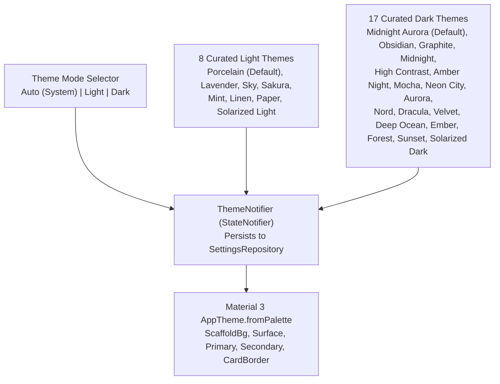

# Design System & Token Specifications — व्यवहार (Vyavahaar)

> **Document Version**: 4.0  
> **Source Files**: `lib/src/core/theme/theme_palette.dart`, `lib/src/core/theme/theme_notifier.dart`, `lib/src/shared/widgets/express_squish.dart`, `lib/src/app/theme/app_theme.dart`  
> **Sole Application Framework**: Flutter + Material 3  
> **Last Updated**: 2026-11-22

---

## 1. Dynamic Theme Architecture & Curated Palettes

Vyavahaar features a full-featured dynamic theme system inspired by `InlitX/streak` with 3 Theme Modes (`Auto (System)`, `Light`, `Dark`), 8 curated Light themes, and 17 curated Dark themes.

### 1.1 Curated Light Palettes (8 Themes)
1. **Porcelain (व्यवहार क्लासिक)**: Warm Cream `#F4EFE7`, Surface `#FFFFFF`, Primary Terracotta `#C05A2B`, Secondary Navy `#1F3352`.
2. **Lavender (लैवेंडर)**: `#F5F3FF`, Surface `#FFFFFF`, Primary `#7C3AED`, Secondary `#4C1D95`.
3. **Sky (आसमानी)**: `#F0F9FF`, Surface `#FFFFFF`, Primary `#0284C7`, Secondary `#0C4A6E`.
4. **Sakura (साकुरा)**: `#FFF1F2`, Surface `#FFFFFF`, Primary `#E11D48`, Secondary `#881337`.
5. **Mint (पुदीना)**: `#F0FDF4`, Surface `#FFFFFF`, Primary `#059669`, Secondary `#064E3B`.
6. **Linen (खादी/लिनन)**: `#FDFBF7`, Surface `#FFFFFF`, Primary `#B45309`, Secondary `#78350F`.
7. **Paper (कागज़)**: `#FAF8F5`, Surface `#FFFFFF`, Primary `#854D0E`, Secondary `#422006`.
8. **Solarized Light**: `#FDF6E3`, Surface `#EEE8D5`, Primary `#268BD2`, Secondary `#073642`.

### 1.2 Curated Dark Palettes (17 Themes)
1. **Midnight Aurora (मिडनाइट ऑरोरा - Default Dark)**: `#0F172A`, Surface `#1E293B`, Primary `#A78BFA`, Secondary `#C084FC`.
2. **Obsidian (ऑब्सिडियन)**: `#09090B`, Surface `#18181B`, Primary `#38BDF8`, Secondary `#0284C7`.
3. **Graphite (ग्रेफाइट)**: `#121417`, Surface `#1E2229`, Primary `#34D399`, Secondary `#059669`.
4. **Midnight (मिडनाइट)**: `#050B14`, Surface `#0B1728`, Primary `#38BDF8`, Secondary `#818CF8`.
5. **High Contrast (हाई कंट्रास्ट)**: `#000000`, Surface `#121212`, Primary `#FACC15`, Secondary `#FFFFFF`.
6. **Amber Night (एम्बर नाइट)**: `#18130C`, Surface `#261D12`, Primary `#F59E0B`, Secondary `#D97706`.
7. **Mocha (मोका)**: `#1E1E2E`, Surface `#313244`, Primary `#CBA6F7`, Secondary `#F38BA8`.
8. **Neon City (नियॉन सिटी)**: `#0D0221`, Surface `#1A0B36`, Primary `#22D3EE`, Secondary `#E879F9`.
9. **Aurora (ऑरोरा)**: `#06181C`, Surface `#0F292F`, Primary `#10B981`, Secondary `#2DD4BF`.
10. **Nord (नॉर्ड)**: `#2E3440`, Surface `#3B4252`, Primary `#88C0D0`, Secondary `#81A1C1`.
11. **Dracula (ड्रेकुला)**: `#282A36`, Surface `#383A59`, Primary `#BD93F9`, Secondary `#FF79C6`.
12. **Velvet (वेलवेट)**: `#180C17`, Surface `#281426`, Primary `#F472B6`, Secondary `#A855F7`.
13. **Deep Ocean (डीप ओशन)**: `#050F1A`, Surface `#0C1E33`, Primary `#38BDF8`, Secondary `#0284C7`.
14. **Ember (एम्बर)**: `#140C08`, Surface `#24160F`, Primary `#F97316`, Secondary `#EA580C`.
15. **Forest (वन)**: `#051B14`, Surface `#0A2E23`, Primary `#34D399`, Secondary `#059669`.
16. **Sunset (सूर्यास्त)**: `#1A0E1A`, Surface `#2D162B`, Primary `#FB7185`, Secondary `#F43F5E`.
17. **Solarized Dark**: `#00212B`, Surface `#002B36`, Primary `#268BD2`, Secondary `#2AA198`.

---

## 2. InlitX/streak Motion & Tactile Tokens

Vyavahaar incorporates fluid spring physics and tactile scale gestures directly adapted from `InlitX/streak`:

### 2.1 ExpressSpring & Motion Constants
- **`ExpressSpring`**: Physics-based damped harmonic oscillator using Flutter's `SpringSimulation.withDampingRatio`:
  - `stiffness`: `380`
  - `dampingRatio`: `0.58`
  - `duration`: `0.52s`
- **Curves**:
  - `Express.bouncy`: Spring simulation curve on touch release.
  - `Express.settle`: `Curves.easeOutCubic` on touch down.
- **Durations**:
  - `Express.fast`: `160ms`
  - `Express.quick`: `280ms`
  - `Express.normal`: `450ms`

### 2.2 ExpressSquish Widget
- Animates scale down to `0.95`–`0.97` on tap down and springs back with bounce on release.
- Applied across buttons, tab items, theme selection cards, and transaction list items.

### 2.3 ExpressCard Widget
- Container with hairline borders (`1px BorderSide`), rounded corners (`16dp` to `20dp`), dynamic dark/light surface colors, and optional tap squish.

---

## 3. Financial Isolation Semantic Palette
- **Mila (Received / मिला)**: `#15803D` / `#209B68` (Light soft bg: `#E2F5EB`, Dark soft bg: `#1B3D27`).
- **Diya (Given / दिया)**: `#B91C1C` / `#DC2626` (Light soft bg: `#FCE9E7`, Dark soft bg: `#451E22`).
- **Planned Status**: `#D97706` (Soft bg: `#FEF3C7` / `#3B2912`).
- Strict rule: Mila and Diya amounts are **never netted** against each other.

---

## 4. Spacing Scale
- `AppSpacing.xs`: `4dp`
- `AppSpacing.sm`: `8dp`
- `AppSpacing.md`: `16dp`
- `AppSpacing.lg`: `20dp`
- `AppSpacing.xl`: `24dp`
- `AppSpacing.floatingTabBottomPadding`: `95dp` (ensures content is never obscured by the floating navigation pill).
