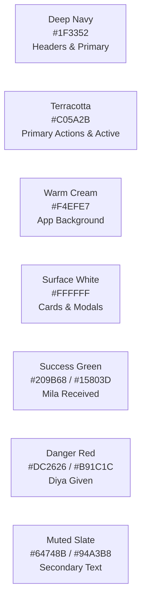

# Design System & Token Specifications — व्यवहार (Vyavahaar)

> **Document Version**: 2.0  
> **Source Files**: `src/constants/Colors.ts`, `src/constants/Strings.ts`, `src/components/ui/`  
> **Last Updated**: 2026-11-21

---

## 1. Color Palette Tokens

### 1.1 Brand Palette
| Token Name | Hex Code | Usage |
| :--- | :--- | :--- |
| `primaryNavy` | `#1F3352` | Header background, primary headings, dark brand elements. |
| `accentTerracotta` | `#C05A2B` | Primary action buttons, active tab pill, chevrons. |
| `backgroundCream` | `#F4EFE7` | Main screen background across all views. |
| `surfaceWhite` | `#FFFFFF` | Card backgrounds, modals, input fields, tab bar pill. |
| `textPrimary` | `#1F3352` | Main body headings, title text. |
| `textMuted` | `#64748B` | Secondary subtitles, timestamps, inactive tab icons. |
| `textSubtle` | `#94A3B8` | Header tagline, tertiary labels. |
| `borderLight` | `#E2E8F0` | Subtle card borders, dividers, outlines. |

### 1.2 Financial Semantic Palette
| Semantic Role | Surface Hex | Accent / Text Hex | Usage |
| :--- | :--- | :--- | :--- |
| **Mila (Received)** | `#E2F5EB` | `#15803D` (`#209B68`) | Received transaction badges, summary card background. |
| **Diya (Given)** | `#FCE9E7` | `#B91C1C` (`#DC2626`) | Given transaction badges, summary card background. |
| **Planned Status** | `#FEF3C7` | `#D97706` | Planned gift badge, pending indicator. |
| **Cancelled Status**| `#F1F5F9` | `#64748B` | Cancelled entry badge. |

---

## 2. Spacing & Corner Radii Scale

All spacing follows an 8dp / 4dp baseline grid:

| Scale Token | Value | Applied To |
| :--- | :--- | :--- |
| `space.xs` | `4dp` | Icon-to-text gaps, inline badges. |
| `space.sm` | `8dp` | Card internal margins, badge padding, list item gaps. |
| `space.md` | `12dp` | Grid gaps, input field padding, modal content padding. |
| `space.lg` | `16dp` | Screen horizontal margins, primary card padding. |
| `space.xl` | `20dp` | Header padding, section separators. |
| `space.tabBottom` | `110dp`| ScrollView content container bottom padding (clears floating bar). |

### Corner Radii (`borderRadius`)
- **Pill Tab Bar**: `36dp` (True capsule).
- **Active Navigation Chip**: `24dp`.
- **Primary & Summary Cards**: `16dp`.
- **Action Tiles & List Cards**: `14dp`.
- **Buttons & Input Fields**: `12dp` or `10dp`.
- **Direction & Status Badges**: `8dp`.

---

## 3. Elevation & Shadow Tokens

- **Card Subtle**: `elevation: 2`, `shadowColor: '#0F172A'`, `shadowOffset: { width: 0, height: 2 }`, `shadowOpacity: 0.04`, `shadowRadius: 6`.
- **Primary Action (Terracotta)**: `elevation: 4`, `shadowColor: '#C05A2B'`, `shadowOffset: { width: 0, height: 4 }`, `shadowOpacity: 0.28`, `shadowRadius: 8`.
- **Floating Tab Bar**: `elevation: 10`, `shadowColor: '#0F172A'`, `shadowOffset: { width: 0, height: 6 }`, `shadowOpacity: 0.14`, `shadowRadius: 18`.

---

## 4. UI Components Specifications

- **`VCard`** (`src/components/ui/index.tsx`): Clean white surface with rounded corners (`12dp`), subtle elevation, and optional `onPress`.
- **`DirectionBadge`**: Compact badge rendering `↓ मिला` (green) or `↑ दिया` (red) with optional small/medium size variants.
- **`AmountInput`**: Accepts and formats numeric input in rupees while passing `paise` integers to the parent form.
- **`VButton`**: Primary (Terracotta `#C05A2B`), Secondary (Navy `#1F3352`), and Danger (Red `#DC2626`) variants with loading spinners and disabled states.
- **`EmptyState`**: Centered icon, title, subtitle, and optional call-to-action button for empty lists.
