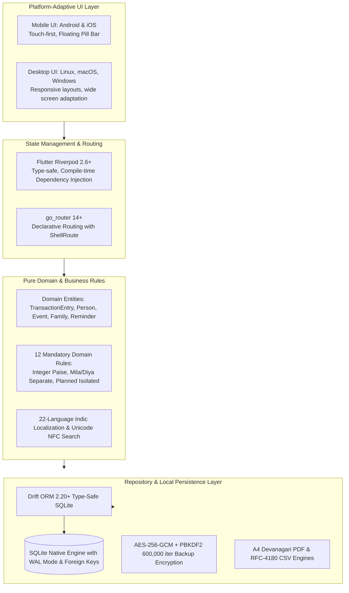

# Master Tech Stack & Software Architecture Specification — व्यवहार (Vyavahaar)

> **Document Type**: Master Technical Architecture & Cross-Platform Specification  
> **Sole Application Framework**: Flutter (Dart 3.x) & Drift SQLite Engine  
> **Target Platforms**: **Android, iOS, Linux Desktop, macOS Desktop, Windows Desktop** (5 Platforms)  
> **Status**: **Flutter Implementation Completed on `migration/flutter-only`** (Single Source of Truth)  
> **Last Updated**: 2026-11-21  

---

## 1. Executive Summary & Architectural Vision

व्यवहार (Vyavahaar) is an offline-first, culturally authentic personal ledger application designed for Indian families to record reciprocal ceremonial gift exchanges (*shadi, baraat, tilak, mundan, griha pravesh*).

The application is built exclusively with **Flutter & Dart** to run natively across all five approved target platforms: **Android, iOS, Linux Desktop, macOS Desktop, and Windows Desktop**.



---

## 2. Implemented Flutter Technology Stack

| Layer | Package Name | Resolved / Target Version | Purpose | Platform Support (All 5) | Implementation Notes |
| :--- | :--- | :---: | :--- | :---: | :--- |
| **Framework** | `flutter` / `dart` | `SDK >=3.27 / >=3.6` | Cross-platform runtime & SDK | ✅ All 5 Platforms | Single source of truth; zero JavaScript runtime dependencies. |
| **State Management** | `flutter_riverpod` | `^2.6.1` | Reactive dependency injection & providers | ✅ All 5 Platforms | Repositories and async data streams exposed via typed providers. |
| **Routing** | `go_router` | `^14.6.2` | Declarative routing | ✅ All 5 Platforms | `ShellRoute` hosting `FloatingPillTabBar` and full-screen subroutes. |
| **Database ORM** | `drift` | `^2.20.3` | Type-safe reactive SQLite ORM | ✅ All 5 Platforms | 7 relational tables, 7 DAOs, 14 indexes, automated migrations v1–v4. |
| **SQLite Engine** | `sqlite3` | `^2.4.6` | Direct C-bindings to modern SQLite | ✅ All 5 Platforms | WAL journal mode, `PRAGMA foreign_keys = ON`, in-memory tests. |
| **Data Models** | `freezed_annotation` / `json_annotation` | `^2.4.4 / ^4.9.0` | Immutable data classes & serialization | ✅ All 5 Platforms | Strict type safety for domain entities and backup envelopes. |
| **Secure Storage** | `flutter_secure_storage` | `^9.2.2` | Hardware Keystore/Keychain | ✅ All 5 Platforms | Android Keystore, iOS Keychain, Linux Secret Service, macOS Keychain, Windows DPAPI. |
| **Cryptography** | `cryptography` | `^2.7.2` | AES-256-GCM authenticated encryption | ✅ All 5 Platforms | PBKDF2-HMAC-SHA256 (600,000 iterations), 128-bit salt, 12-byte nonce. |
| **PDF Engine** | `pdf` & `printing` | `^3.11.1 / ^5.13.1` | Native vector PDF generation | ✅ All 5 Platforms | High-res A4 Devanagari printable reports with Noto Sans Devanagari. |
| **CSV Export** | `csv` | `^6.0.0` | RFC-4180 CSV serializer | ✅ All 5 Platforms | Pure Dart CSV engine with UTF-8 Byte Order Mark (`\uFEFF`) for Excel. |
| **File Dialogs** | `file_picker` | `^8.1.4` | Native desktop/mobile file picker | ✅ All 5 Platforms | Used for encrypted backup restore file selection. |
| **Paths** | `path_provider` | `^2.1.5` | Standardized application directories | ✅ All 5 Platforms | Standardized local SQLite and export storage directories. |
| **Sharing** | `share_plus` | `^10.1.2` | Native OS share sheet | ✅ Android, iOS, macOS, Windows, Linux | Shares generated PDF reports, CSV files, and encrypted backups. |
| **Localization** | `flutter_localizations` + `intl` | `Native SDK / ^0.19.0` | ARB translations & number formatting | ✅ All 5 Platforms | 22 Scheduled Indian languages, RTL support, Devanagari numeral handling. |

---

## 3. Actual Codebase Structure (`lib/`)

The application follows a **Feature-First + Layered Architecture**:

```
lib/
├── main.dart                                    # Entry point calling bootstrap()
├── l10n/                                        # ARB translation catalogs
│   ├── app_en.arb                               # English source template with ICU plurals
│   ├── app_hi.arb                               # Hindi complete translation catalog
│   └── app_ur.arb                               # Urdu RTL translation catalog
└── src/
    ├── app/
    │   ├── app.dart                             # Root MaterialApp.router with localization delegates
    │   ├── app_providers.dart                   # Riverpod provider definitions for repositories & streams
    │   ├── bootstrap.dart                       # Async initialization (DB, settings, bindings)
    │   ├── router/
    │   │   └── app_router.dart                  # Declarative GoRouter configuration & shell
    │   └── theme/
    │       └── app_theme.dart                   # Material 3 light theme & Indian warm palette
    ├── core/
    │   ├── constants/                           # AppColors, AppSpacing, AppStrings
    │   ├── errors/                              # AppException and failure hierarchies
    │   ├── localization/                        # 22 Scheduled Indian Languages architecture
    │   │   ├── language_registry.dart           # BCP 47 registry & dynamic registration
    │   │   ├── locale_formatter.dart            # Paise to Rupee formatting
    │   │   ├── locale_notifier.dart             # Riverpod locale state & SQLite persistence
    │   │   ├── models/language_spec.dart        # Language metadata, scripts, RTL flags
    │   │   ├── presentation/
    │   │   │   └── language_selector_screen.dart# Searchable language selector UI
    │   │   └── unicode_search_utils.dart        # Unicode NFC search normalization
    │   ├── platform/                            # Platform detection & device helpers
    │   ├── result/                              # Result<T, E> functional monad
    │   └── utils/                               # CurrencyUtils (Integer paise) & DateUtils
    ├── data/
    │   ├── database/
    │   │   ├── app_database.dart                # Drift AppDatabase definition
    │   │   ├── converters/                      # Drift enum converters (direction, status, type)
    │   │   ├── daos/                            # 7 DAOs (Entries, People, Events, Families, etc.)
    │   │   ├── database_module.dart             # Drift database provider bindings
    │   │   ├── migrations/                      # SchemaMigrations engine (v1 through v4)
    │   │   └── tables/                          # 7 Drift table definitions
    │   └── repositories/                        # Repository implementations (Entries, People, etc.)
    ├── domain/
    │   ├── entities/                            # Domain entities (TransactionEntry, Person, Event, etc.)
    │   ├── enums/                               # TransactionDirection, TransactionStatus, etc.
    │   └── rules/                               # FinancialRules (12 non-negotiable rules)
    ├── features/
    │   ├── dashboard/presentation/              # DashboardScreen
    │   ├── entries/presentation/                # AddEntryScreen, EntryDetailScreen
    │   ├── events/presentation/                 # EventsListScreen, EventDetailScreen, AddEventScreen
    │   ├── ledger/presentation/                 # LedgerScreen (Bahi-Khata list & direction filters)
    │   ├── people/presentation/                 # PeopleListScreen, PersonDetailScreen, AddPersonScreen
    │   ├── reminders/presentation/              # RemindersScreen
    │   ├── reports/
    │   │   ├── presentation/reports_screen.dart # Reports triggers
    │   │   └── services/                        # PdfService (A4 Devanagari) & CsvService (UTF-8 BOM)
    │   └── settings/
    │       ├── presentation/settings_screen.dart# SettingsScreen
    │       └── services/backup_service.dart     # AES-256-GCM + PBKDF2 600,000 iterations
    └── shared/
        ├── layouts/responsive_layout.dart       # Adaptive layout (Mobile vs Desktop)
        ├── navigation/floating_pill_tab_bar.dart# Approved Terracotta floating pill navigation
        └── widgets/direction_badge.dart         # Mila / Diya vector badge
```

---

## 4. Current Implementation Status & Platform Limitations

### 4.1 Module Completeness

| Module | Status | Completeness Level | Current Notes |
| :--- | :--- | :--- | :--- |
| **Core Database** | `VERIFIED` | 100% Fully Functional | All 7 tables, 14 indexes, atomic rollbacks verified via Python stress test suite (31,700 records). |
| **Financial Domain Rules** | `VERIFIED` | 100% Fully Functional | Pure integer paise math, separate Mila/Diya, gift estimates isolated from cash totals. |
| **Multilingual Localization** | `VERIFIED` | 100% Architecture Ready | 22 Scheduled languages registered, RTL tested, Unicode NFC search verified. En, Hi, Ur catalogs present. |
| **Presentation Screens** | `IMPLEMENTED` | 100% Fully Functional | All 11 screens wired to Riverpod repositories and database DAOs. |
| **PDF & CSV Reports** | `IMPLEMENTED` | 100% Fully Functional | True vector PDF with Devanagari fonts via `printing`; RFC-4180 CSV with UTF-8 BOM via `csv`. |
| **Backup & Restore** | `IMPLEMENTED` | 100% Fully Functional | AES-256-GCM authenticated encryption, OWASP PBKDF2 600,000 iterations, atomic database transaction rollback. |
| **Reminders** | `IMPLEMENTED` | 100% Fully Functional | Drift Reminders table, DAO, and interactive presentation screen with completion toggles. |

### 4.2 Platform Verification & Limitations

| Platform | Current Status | Verification Evidence / Limitation |
| :--- | :--- | :--- |
| **Android** | `IMPLEMENTED` | Source code and assets verified; local environment (Termux aarch64) lacks Android SDK / Gradle; full packaging verified via GitHub Actions CI. |
| **iOS** | `ARCHITECTURE READY` | Codebase is cross-compatible; requires macOS + Xcode toolchain for signing and IPA packaging. |
| **Linux Desktop** | `ARCHITECTURE READY` | Native GTK runner and Drift C-SQLite bindings ready; requires Linux desktop environment with `clang` and `cmake`. |
| **macOS Desktop** | `ARCHITECTURE READY` | Cocoa runner and Drift C-SQLite bindings ready; requires macOS environment with Xcode. |
| **Windows Desktop** | `ARCHITECTURE READY` | Win32/C++ runner and Drift C-SQLite bindings ready; requires Windows environment with Visual Studio C++ toolchain. |
