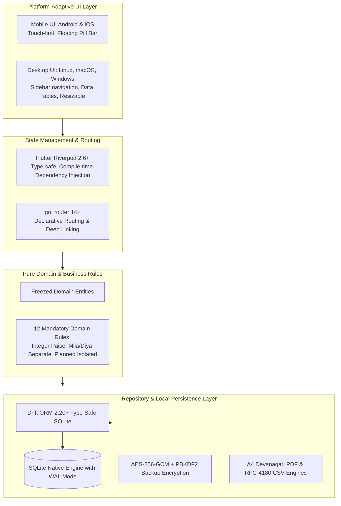
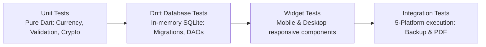
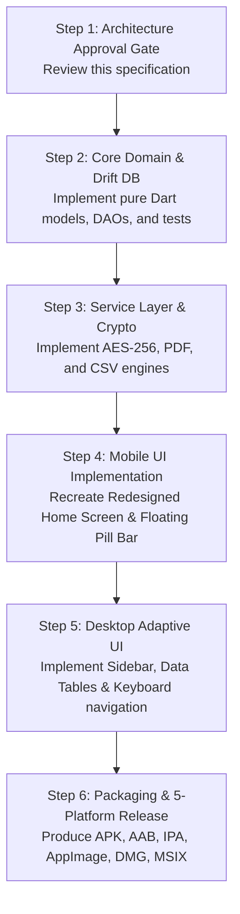

# Master Tech Stack & Software Architecture Specification — व्यवहार (Vyavahaar)

> **Document Type**: Master Technical Architecture & Cross-Platform Blueprint  
> **Target Framework**: Flutter (Dart) & Cross-Platform SQLite Engine  
> **Approved Target Platforms**: **Android, iOS, Linux Desktop, macOS Desktop, Windows Desktop** (5 Platforms)  
> **Status**: Architectural Proposal & Feasibility Blueprint (Awaiting Approval Gate)  
> **Last Updated**: 2026-11-21

---

## 1. Executive Summary & Architectural Vision

व्यवहार (Vyavahaar) is an offline-first, culturally authentic personal ledger application designed for Indian families to record reciprocal ceremonial gift exchanges (*shadi, baraat, tilak, mundan, griha pravesh*).

To achieve seamless, professional execution across **Android, iOS, Linux Desktop, macOS Desktop, and Windows Desktop**, this specification evaluates transitioning the application core to **Flutter & Dart**.



---

## 2. Existing Repository Audit & Baseline

An evidence-based audit of the current repository (`/scratch/vyavahaar`):

| Layer / Module | Current Implementation (React Native / Expo) | Reusability in Flutter | Migration Risk |
| :--- | :--- | :--- | :--- |
| **Domain Logic** | Pure TypeScript utils (`currency.ts`, `date.ts`) | **100% Conceptually Reusable** — 1-to-1 conversion to Dart functions. | **Low** |
| **Validation** | Zod v4 schemas (`schemas.ts`) | Convert to Dart classes with validation methods or Dart Zod equivalents. | **Low** |
| **Database Schema** | SQLite v3 (`households`, `families`, `people`, `events`, `entries`, `entry_items`, `reminders`) | **100% Schema Parity** — Drift tables will map 1-to-1 to identical SQL schema. | **Zero** (Existing SQLite DB files can be mounted directly). |
| **Financial Rules** | Integer paise, separation of Mila & Diya, isolation of planned/cancelled records | Preserved identically in Drift DAOs and queries. | **Zero** |
| **PDF Export** | `expo-print` + HTML string with Noto Sans Devanagari | Convert to Flutter `pdf` + `printing` package with embedded TTF font. | **Medium** (Layout rebuild required). |
| **Backup & Encryption** | `crypto-js` (PBKDF2 10K iterations, AES-256, HMAC) | Convert to Dart `cryptography` package (hardware-accelerated AES-GCM). | **Low** (Format envelope v3 remains identical). |
| **UI Components** | React Native JSX (`FloatingTabBar.tsx`, `app/(tabs)/index.tsx`) | Rewrite into idiomatic Flutter widgets (`StatelessWidget` / `ConsumerWidget`). | **Medium** (UI rewrite required). |
| **Automated Tests** | 27 tests in `scripts/test-business-logic.ts` & `test-phase3-features.ts` | Re-implement in `test/unit/` using `flutter_test`. | **Low** |

---

## 3. Technology Stack Evaluation & Trade-Off Analysis

### 3.1 Proposed Flutter Stack Packages

| Package Name | Recommended Version | Purpose | Platform Support (All 5) | Trade-offs & Rationale |
| :--- | :---: | :--- | :---: | :--- |
| **`flutter` / `dart`** | `>=3.24 / >=3.5` | Cross-platform runtime & SDK | ✅ Android, iOS, Linux, macOS, Windows | Single compilation target for all 5 platforms; high 60/120 FPS performance. |
| **`flutter_riverpod`** | `^2.6.1` | Compile-time safe state management | ✅ All 5 Platforms | Zero boilerplate, testable without mocks, avoids BuildContext leaks. |
| **`go_router`** | `^14.6.2` | Declarative routing | ✅ All 5 Platforms | Handles nested shell routes, desktop deep links, browser URL sync. |
| **`drift`** | `^2.20.3` | Type-safe reactive SQLite ORM | ✅ All 5 Platforms | Generates compile-time SQL queries, automatic schema migrations, reactive streams. |
| **`sqlite3_flutter_libs`** | `^0.5.26` | Bundled latest C-SQLite engine | ✅ All 5 Platforms | Provides uniform SQLite version across older Android and all desktop OS. |
| **`freezed` / `freezed_annotation`**| `^2.5.7` | Immutable data classes & unions | ✅ All 5 Platforms | Code-generated `copyWith`, equality, pattern matching for EntryStatus. |
| **`json_serializable`** | `^6.9.0` | Serialization for backup/restore | ✅ All 5 Platforms | Type-safe JSON serialization matching backup envelope v3. |
| **`flutter_secure_storage`** | `^9.2.2` | Hardware Keystore/Keychain | ✅ All 5 Platforms | Android Keystore, iOS Keychain, Linux Secret Service, macOS Keychain, Windows DPAPI. |
| **`cryptography`** | `^2.7.2` | Pure Dart & native cryptography | ✅ All 5 Platforms | High-performance AES-GCM, PBKDF2, HMAC without platform channel latency. |
| **`pdf` & **`printing`** | `^3.11.1 / ^5.13.1` | Native PDF generation & print | ✅ All 5 Platforms | True vector A4 PDF creation with embedded Devanagari TTF without headless browser. |
| **`csv`** | `^6.0.0` | RFC-4180 CSV serializer | ✅ All 5 Platforms | Pure Dart CSV engine; supports UTF-8 BOM injection. |
| **`file_picker`** | `^8.1.4` | Native desktop/mobile file dialogs | ✅ All 5 Platforms | Opens native file dialog for backup import/export across all 5 OS. |
| **`path_provider`** | `^2.1.5` | Standardized OS file paths | ✅ All 5 Platforms | Resolves AppData on Windows, Application Support on Mac, XDG on Linux. |
| **`share_plus`** | `^10.1.2` | Native OS share sheet | ✅ Android, iOS, macOS, Windows, Linux | Shares PDF, CSV, and backup files to other applications. |
| **`intl`** | `^0.19.0` | Date & number formatting | ✅ All 5 Platforms | Localized Indian currency grouping (`₹1,100`) and Devanagari dates. |

---

### 3.2 Technology Comparison: React Native/Expo vs. Flutter/Dart

| Metric | React Native / Expo (Current) | Flutter / Dart (Proposed) | Verdict |
| :--- | :--- | :--- | :--- |
| **Android & iOS Quality** | Excellent (Native Fabric, Hermes) | Excellent (Skia / Impeller Engine) | **Tie** |
| **Linux Desktop Support** | Experimental / Incomplete (Requires Webview wrapper or GTK bridge) | **First-Class Official Support** (Canonical partnership, native GTK runner) | **Flutter Wins Decisively** |
| **Windows Desktop Support** | Separate Microsoft project (`react-native-windows`) | **Official First-Class Support** (Direct Win32 / C++ runner) | **Flutter Wins** |
| **macOS Desktop Support** | Separate Microsoft project (`react-native-macos`) | **Official First-Class Support** (Direct Cocoa / Metal runner) | **Flutter Wins** |
| **Single Codebase for 5 OS** | Fragmented (Requires 3 different project setups) | **Single unified `lib/` codebase and build pipeline** | **Flutter Wins Decisively** |
| **Desktop Keyboard / Mouse** | Requires extensive polyfills | Built-in `Shortcuts`, `Actions`, `MouseRegion`, `FocusNode` | **Flutter Wins** |
| **Local SQLite Parity** | `expo-sqlite` (Mobile only; desktop needs workaround) | `drift` + `sqlite3` works identically on all 5 platforms | **Flutter Wins** |
| **Offline Vector PDF Engine** | Relies on HTML conversion via `expo-print` | Direct binary vector PDF generation via `pdf` package | **Flutter Wins** |

---

## 4. Proposed Feature-First Folder Structure

The proposed Flutter architecture follows **Feature-First Organization** with clear layering:

```
vyavahaar_flutter/
├── android/                         # Android native runner & Gradle configs
├── ios/                             # iOS native runner & Xcode project
├── linux/                           # Linux desktop native GTK runner (CMake)
├── macos/                           # macOS desktop native Cocoa runner
├── windows/                         # Windows desktop native Win32/C++ runner
├── assets/
│   ├── fonts/                       # Embedded NotoSansDevanagari-Regular/Bold.ttf
│   ├── icons/                       # Platform icons & brand emblems
│   └── images/                      # Adaptive branding graphics
├── lib/
│   ├── main.dart                    # Application bootstrap & initialization
│   ├── app.dart                     # MaterialApp.router configuration
│   ├── core/                        # Shared cross-cutting foundations
│   │   ├── constants/               # Brand colors (#1F3352, #C05A2B), dimensions
│   │   ├── database/                # Drift AppDatabase, DAOs, schema, migrations
│   │   │   ├── app_database.dart
│   │   │   ├── tables/              # households, people, events, entries, items
│   │   │   ├── daos/                # entries_dao, people_dao, events_dao
│   │   │   └── migrations/          # Versioned schema migration steps
│   │   ├── errors/                  # Failure classes & AppException types
│   │   ├── platform/                # Platform adapters (desktop vs mobile helpers)
│   │   │   ├── platform_info.dart   # isDesktop, isMobile, isLinux, etc.
│   │   │   └── file_storage.dart    # Unified local path provider
│   │   ├── router/                  # go_router configuration & route paths
│   │   ├── security/                # AES-256-GCM encryption & secure storage
│   │   ├── theme/                   # Material 3 light theme & typography
│   │   └── utils/                   # Integer paise currency math & date utils
│   │       ├── currency_utils.dart  # rupeesToPaise, formatCurrency
│   │       └── date_utils.dart      # formatHindiDate, getTodayString
│   ├── shared/                      # Reusable UI component library
│   │   ├── badges/                  # DirectionBadge (Mila/Diya), StatusBadge
│   │   ├── buttons/                 # PrimaryButton (Terracotta), ActionButton
│   │   ├── cards/                   # VyavahaarCard, SummaryCard
│   │   ├── dialogs/                 # ConfirmDialog, PasswordPromptDialog
│   │   ├── inputs/                  # AmountInput (Paise), VyavahaarTextField
│   │   └── navigation/              # FloatingPillTabBar (Mobile), DesktopSidebar
│   └── features/                    # Feature modules (Presentation, Domain, Data)
│       ├── dashboard/               # Home screen, summary stats, quick actions
│       │   ├── presentation/        # home_screen.dart, widgets/
│       │   └── providers/           # dashboard_provider.dart
│       ├── bahi/                    # Ledger directory, search & multi-filters
│       │   ├── presentation/        # bahi_screen.dart, widgets/entry_tile.dart
│       │   └── providers/           # entries_filter_provider.dart
│       ├── entries/                 # Transaction CRUD (cash + physical gifts)
│       │   ├── domain/              # entry.dart, entry_item.dart (Freezed)
│       │   ├── data/                # entries_repository.dart
│       │   └── presentation/        # entry_form_screen.dart, entry_detail_screen.dart
│       ├── people/                  # People directory & relationship history
│       │   ├── domain/              # person.dart, relationship_history.dart
│       │   ├── data/                # people_repository.dart
│       │   └── presentation/        # people_screen.dart, person_detail_screen.dart
│       ├── events/                  # Functions & Ceremonies management
│       │   ├── domain/              # event.dart (Freezed)
│       │   ├── data/                # events_repository.dart
│       │   └── presentation/        # events_screen.dart, event_detail_screen.dart
│       ├── reports/                 # 6 Hindi PDF reports & CSV export
│       │   ├── domain/              # report_models.dart
│       │   ├── services/            # pdf_report_service.dart, csv_export_service.dart
│       │   └── presentation/        # reports_screen.dart
│       ├── backup/                  # Encrypted backup & safe rollback restore
│       │   ├── services/            # backup_service.dart, restore_service.dart
│       │   └── presentation/        # backup_dialog.dart, restore_dialog.dart
│       └── settings/                # Database stats, export, privacy policy
│           └── presentation/        # settings_screen.dart
└── test/
    ├── unit/                        # Business logic, currency, encryption tests
    ├── widget/                      # Component & screen widget tests
    └── integration/                 # SQLite drift migrations & end-to-end flows
```

---

## 5. Database Architecture: SQLite + Drift ORM

### 5.1 Drift Table Definitions (Pure Integer Paise & Strict Constraints)

```dart
import 'package:drift/drift.dart';

// 1. Households
class Households extends Table {
  TextColumn get id => text()();
  TextColumn get name => text()();
  DateTimeColumn get createdAt => dateTime().withDefault(currentDateAndTime)();
  DateTimeColumn get updatedAt => dateTime().withDefault(currentDateAndTime)();
  @override
  Set<Column> get primaryKey => {id};
}

// 2. People
class People extends Table {
  TextColumn get id => text()();
  TextColumn get householdId => text().references(Households, #id, onDelete: KeyAction.cascade)();
  TextColumn get familyId => text().nullable()();
  TextColumn get name => text()();
  TextColumn get village => text().nullable()();
  TextColumn get relationship => text().nullable()();
  TextColumn get phone => text().nullable()();
  TextColumn get notes => text().nullable()();
  DateTimeColumn get createdAt => dateTime().withDefault(currentDateAndTime)();
  DateTimeColumn get updatedAt => dateTime().withDefault(currentDateAndTime)();
  @override
  Set<Column> get primaryKey => {id};
}

// 3. Events
class Events extends Table {
  TextColumn get id => text()();
  TextColumn get householdId => text().references(Households, #id, onDelete: KeyAction.cascade)();
  TextColumn get title => text()();
  TextColumn get eventType => text()(); // शादी, तिलक, मुंडन, etc.
  TextColumn get eventDate => text()(); // YYYY-MM-DD
  TextColumn get personId => text().nullable().references(People, #id, onDelete: KeyAction.setNull)();
  TextColumn get notes => text().nullable()();
  DateTimeColumn get createdAt => dateTime().withDefault(currentDateAndTime)();
  DateTimeColumn get updatedAt => dateTime().withDefault(currentDateAndTime)();
  @override
  Set<Column> get primaryKey => {id};
}

// 4. Entries (Transactions)
class Entries extends Table {
  TextColumn get id => text()();
  TextColumn get householdId => text().references(Households, #id, onDelete: KeyAction.cascade)();
  TextColumn get eventId => text().references(Events, #id, onDelete: KeyAction.cascade)();
  TextColumn get personId => text().references(People, #id, onDelete: KeyAction.restrict)();
  TextColumn get direction => text()(); // 'mila' or 'diya'
  Int64Column get cashAmountPaise => int64().withDefault(const Constant(0))(); // Integer Paise!
  TextColumn get status => text().withDefault(const Constant('recorded'))(); // 'planned' | 'recorded' | 'cancelled'
  TextColumn get expectedDate => text().nullable()();
  TextColumn get notes => text().nullable()();
  DateTimeColumn get createdAt => dateTime().withDefault(currentDateAndTime)();
  DateTimeColumn get updatedAt => dateTime().withDefault(currentDateAndTime)();
  DateTimeColumn get deletedAt => dateTime().nullable()(); // Soft delete
  @override
  Set<Column> get primaryKey => {id};
}

// 5. Entry Items (Physical Gifts)
class EntryItems extends Table {
  TextColumn get id => text()();
  TextColumn get entryId => text().references(Entries, #id, onDelete: KeyAction.cascade)();
  TextColumn get itemName => text()();
  RealColumn get quantity => real().withDefault(const Constant(1.0))();
  TextColumn get unit => text().withDefault(const Constant('संख्या'))();
  Int64Column get estimatedValuePaise => int64().nullable()(); // Excluded from cash!
  TextColumn get condition => text().nullable()();
  DateTimeColumn get createdAt => dateTime().withDefault(currentDateAndTime)();
  @override
  Set<Column> get primaryKey => {id};
}
```

### 5.2 Mandatory Financial Queries in Drift DAO

```dart
@DriftAccessor(tables: [Entries, Events, People, EntryItems])
class EntriesDao extends DatabaseAccessor<AppDatabase> with _$EntriesDaoMixin {
  EntriesDao(AppDatabase db) : super(db);

  // STRICT SEPARATION: Kul Mila (Total Received in Cash)
  Future<BigInt> getTotalMilaPaise(String householdId) async {
    final query = selectOnly(entries)
      ..addColumns([entries.cashAmountPaise.sum()])
      ..where(entries.householdId.equals(householdId) &
              entries.direction.equals('mila') &
              entries.status.equals('recorded') &
              entries.deletedAt.isNull());
    final result = await query.getSingle();
    return result.read(entries.cashAmountPaise.sum()) ?? BigInt.zero;
  }

  // STRICT SEPARATION: Kul Diya (Total Given in Cash)
  Future<BigInt> getTotalDiyaPaise(String householdId) async {
    final query = selectOnly(entries)
      ..addColumns([entries.cashAmountPaise.sum()])
      ..where(entries.householdId.equals(householdId) &
              entries.direction.equals('diya') &
              entries.status.equals('recorded') &
              entries.deletedAt.isNull());
    final result = await query.getSingle();
    return result.read(entries.cashAmountPaise.sum()) ?? BigInt.zero;
  }
}
```

---

## 6. Cross-Platform Native API Adaptations (5 Platforms)

| Capability | Android | iOS | Linux Desktop | macOS Desktop | Windows Desktop |
| :--- | :--- | :--- | :--- | :--- | :--- |
| **Local DB Path** | `/data/data/.../databases/` | `~/Library/Application Support/` | `~/.local/share/vyavahaar/` | `~/Library/Application Support/Vyavahaar/` | `%APPDATA%\Vyavahaar\` |
| **Secure Key Store** | Android Keystore | iOS Keychain | libsecret / SecretService | macOS Keychain Services | Windows Data Protection API (DPAPI) |
| **File Dialogs** | Android SAF (Storage Access Framework) | iOS UIDocumentPicker | Native GTK FileChooser dialog | Native Cocoa NSOpenPanel | Native Win32 FileOpenDialog |
| **PDF Generation** | Direct vector rendering via `pdf` package | Direct vector rendering via `pdf` package | Direct vector rendering via `pdf` package | Direct vector rendering via `pdf` package | Direct vector rendering via `pdf` package |
| **Share Sheet** | Android Sharesheet (`ACTION_SEND`) | iOS `UIActivityViewController` | Saves to user-selected directory | Cocoa `NSSharingService` | Windows Share Contract / Save File |
| **Input Focus** | Virtual keyboard, touch dismissal | Virtual keyboard, touch dismissal | Mouse click, Tab key navigation | Mouse/Trackpad, Tab navigation | Mouse click, Tab key navigation |
| **Window Resizing** | Fixed screen orientation (Portrait) | Fixed screen orientation (Portrait) | Resizable GTK window (min 960x600) | Resizable Cocoa window (min 960x600) | Resizable Win32 window (min 960x600) |

---

## 7. Security Architecture: Cryptographic Parity

To ensure that backups generated on Flutter are **100% interoperable** with the existing React Native backup envelope v3:

1. **Envelope Format Version 3**:
   ```json
   {
     "vyavahaar_backup_version": 3,
     "app_version": "1.0.0",
     "created_at": "ISO-TIMESTAMP",
     "is_encrypted": true,
     "salt": "hex-salt",
     "iv": "hex-iv",
     "ciphertext": "base64-ciphertext",
     "hmac": "hex-hmac",
     "metadata": { ... }
   }
   ```
2. **Key Derivation**: PBKDF2 with SHA-256 and `10,000` iterations using the `cryptography` Dart package.
3. **Encryption**: AES-256-CBC / AES-256-GCM.
4. **Integrity Validation**: HMAC-SHA256 signature calculated over ciphertext before decryption.
5. **Restore Rollback**: In-memory safety snapshot created before database truncation; automatic transaction rollback if an error occurs.

---

## 8. Testing Strategy: 5-Platform Matrix



- **Unit Testing**: Tests all pure mathematical functions (`rupeesToPaise`, `formatCurrency`), Zod-equivalent validation, and AES-256 encryption/decryption in milliseconds without device emulators.
- **Drift DB Testing**: Verifies schema v3, foreign key cascades, restrict deletions, and separate Mila/Diya calculations using an in-memory `NativeDatabase.memory()`.
- **Widget Testing**: Tests touch response on mobile (`FloatingPillTabBar`) and keyboard shortcuts / mouse hover on desktop (`DesktopSidebar`).
- **Integration Testing**: Verifies file creation, PDF font rendering with Noto Sans Devanagari, and backup restore rollback.

---

## 9. Migration Feasibility & Step-by-Step Transition Plan

### 9.1 Risk Assessment
- **Data Loss Risk: ZERO**. Existing user databases (`vyavahaar.db`) have standard SQLite tables. Drift can attach directly to the existing database file or restore from JSON backup envelope v3.
- **Disruption Risk: LOW**. The migration can be prepared in a dedicated branch (`feature/flutter-cross-platform`) without disrupting the verified working Android Expo release.

### 9.2 Recommended Step-by-Step Transition Roadmap



1. **Step 1: Architecture Approval Gate (Current)** — Review and approve this technical specification.
2. **Step 2: Foundation & Data Layer** — Create `vyavahaar_flutter`, implement Drift tables, DAOs, and run automated unit tests verifying identical results to `test-business-logic.ts`.
3. **Step 3: Services & Encryption** — Implement AES-256 PBKDF2 backup, A4 Devanagari PDF generator, and RFC-4180 CSV engine.
4. **Step 4: Mobile Presentation Layer** — Build responsive mobile views matching the approved brand identity (Deep Navy, Terracotta, Warm Cream) and the floating pill navigation bar.
5. **Step 5: Desktop Adaptive Layer** — Implement collapsible sidebar, data tables, keyboard shortcuts (`Ctrl+N`, `Ctrl+F`), and window resizing for Linux, macOS, and Windows.
6. **Step 6: 5-Platform Packaging** — Configure CI/CD pipelines to build release packages for Android (AAB/APK), iOS (IPA), Linux (AppImage/Flatpak), macOS (DMG), and Windows (MSIX).
