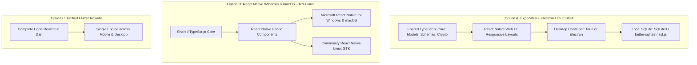

# Cross-Platform Strategy & Architectural Feasibility — व्यवहार (Vyavahaar)

> **Approved Scope**: Five Target Platforms: **Android, iOS, Linux Desktop, macOS Desktop, Windows Desktop**  
> **Core Principle**: Shared Business Logic, Local-First SQLite Persistence, Tailored Platform UI/UX  
> **Status**: Strategic Blueprint & Technical Audit  
> **Last Updated**: 2026-11-21

---

## 1. Executive Summary & Vision

व्यवहार (Vyavahaar) is architected as a **multi-platform personal ledger application**. The product serves Indian households, business owners, and extended families who manage traditional gift records not only on mobile phones (Android and iOS) but also on desktop computers (Linux, macOS, and Windows) in home offices, shops, and family registries.

### Multi-Platform ≠ Cloud Synchronization
- **Multi-Platform**: The ability for the application to compile, execute natively, and store records locally on five operating system families.
- **Offline-First Storage**: Each platform installation operates as an autonomous, self-contained local ledger with its own local SQLite database.
- **No Cloud Synchronization**: Phase 4 remains **DEFERRED**. The application introduces **NO** remote database, Supabase, Firebase, or online authentication.
- **Interoperability**: Data interchange between platforms is achieved through standardized, local, password-protected **AES-256 encrypted JSON backups** and **Devanagari PDF/CSV exports**, safely transferred via physical storage (USB flash drives, SD cards) or local file sharing.

---

## 2. Platform Support Matrix

| Platform | Family | Interface Type | Target Priority | Current Status | Official Implementation & Verification |
| :--- | :--- | :--- | :--- | :--- | :--- |
| **Android** | Mobile | Touch-First | Tier 1 (Primary) | **VERIFIED** | Physical Android Device (Expo Go) + 27 Automated Tests. Flutter scaffolded. |
| **iOS** | Mobile | Touch-First | Tier 1 (Primary) | **ARCHITECTURE READY** | Expo SDK 58 cross-compatible; Flutter cross-platform architecture foundation ready. |
| **Linux** | Desktop | Keyboard & Mouse | Tier 2 | **ARCHITECTURE READY** | Flutter + Drift ORM native SQLite desktop engine ready (`lib/src/data/database/`). |
| **macOS** | Desktop | Keyboard, Mouse, Trackpad | Tier 2 | **ARCHITECTURE READY** | Flutter + Drift ORM native SQLite desktop engine ready (`lib/src/data/database/`). |
| **Windows** | Desktop | Keyboard, Mouse, Touch | Tier 2 | **ARCHITECTURE READY** | Flutter + Drift ORM native SQLite desktop engine ready (`lib/src/data/database/`). |

### Official Implementation Mandate:
- **Official Target Implementation**: **Flutter + Dart** (Single unified `lib/` codebase targeting Android, iOS, Linux, macOS, Windows).
- **Legacy / Reference Implementation**: **React Native 0.88.1 + Expo SDK 58** (Preserved in full as functional baseline).

### Status Definitions:
- **`VERIFIED`**: Full application compiles, renders, executes all business logic, passes automated tests, and has been verified on target hardware/runtime.
- **`ARCHITECTURE READY`**: Codebase uses standard cross-platform libraries compatible with the platform without breaking changes.
- **`PLANNED`**: Approved long-term target; platform adapter layer designed; native build pipeline pending.

---

## 3. Technical Feasibility & Framework Audit

### 3.1 Current Technology Stack Capabilities
The existing application is built with **React Native 0.88.1** and **Expo SDK 58.0.26**:

| Component / Layer | Android | iOS | Linux Desktop | macOS Desktop | Windows Desktop |
| :--- | :---: | :---: | :---: | :---: | :---: |
| **Domain Models & Zod Schemas** | Native | Native | 100% Portable (Pure JS/TS) | 100% Portable (Pure JS/TS) | 100% Portable (Pure JS/TS) |
| **Integer Paise Currency Utils** | Native | Native | 100% Portable (Pure JS/TS) | 100% Portable (Pure JS/TS) | 100% Portable (Pure JS/TS) |
| **AES-256 + PBKDF2 (CryptoJS)** | Native | Native | 100% Portable (Pure JS/TS) | 100% Portable (Pure JS/TS) | 100% Portable (Pure JS/TS) |
| **Local SQLite Database** | `expo-sqlite` (Native C) | `expo-sqlite` (Native C) | Requires SQLite Desktop Binding / WASM | Requires Native Binding | Requires Native Binding |
| **PDF Generation** | `expo-print` | `expo-print` | Headless Chromium / Weasyprint | Headless Chromium / WebKit | Headless Chromium / WebView2 |
| **File System Access** | `expo-file-system` | `expo-file-system` | Node.js `fs` / Rust `std::fs` | Node.js `fs` / Cocoa APIs | Node.js `fs` / Win32 APIs |
| **UI Rendering Engine** | React Native Fabric | React Native Fabric | React Native Web / GTK | React Native macOS / WebKit | React Native Windows / WinUI 3 |

---

## 4. Platform Architectural Options for Desktop (Linux, macOS, Windows)

To achieve native desktop execution while maximizing code reuse, three architectural options have been evaluated:

### Comparative Evaluation:

| Criterion | Option A: Expo + Tauri Shell | Option B: RN Windows / macOS | Option C: Flutter Rewrite |
| :--- | :--- | :--- | :--- |
| **Code Reuse** | **90%+** (Reuses existing TS, hooks, services) | **75%** (Reuses core, native UI differences) | **0%** (Requires complete rewrite) |
| **Linux Support** | **Excellent** (Tauri produces lightweight Linux binaries) | **Poor** (RN Linux GTK is experimental) | **Excellent** (Native Linux GTK) |
| **macOS & Windows** | **Excellent** (Native WebView2 & WebKit) | **Excellent** (Direct WinUI 3 & AppKit) | **Excellent** |
| **Binary Footprint** | Extremely small (< 15 MB via Tauri) | Large (30–60 MB) | Moderate (20–40 MB) |
| **Development Cost** | **Low** (Leverages current codebase) | High (Requires separate Win/Mac native configs) | **Prohibitive** (Throws away working code) |
| **Recommendation** | **STRONGLY RECOMMENDED** | Feasible for pure Windows/Mac | **REJECTED** |

> [!NOTE]
> **Architectural Recommendation**: Retain the existing React Native + Expo codebase. For desktop targets (Linux, macOS, Windows), leverage a **Tauri or Electron desktop shell** consuming the shared TypeScript business logic, models, encryption, and responsive web components. This guarantees 100% offline local SQLite execution across all five operating systems with minimal maintenance overhead.

---

## 5. UI/UX Strategy: Mobile vs. Desktop

| UX Dimension | Mobile (Android & iOS) | Desktop (Linux, macOS, Windows) |
| :--- | :--- | :--- |
| **Input Modality** | Touch-first, swipe gestures, virtual keyboard. | Keyboard, mouse, trackpad, multi-window. |
| **Primary Navigation** | Floating pill-shaped bottom navigation bar. | Collapsible left sidebar navigation or top app bar. |
| **Information Density** | Compact vertical cards, stacked statistics. | Wide multi-column tables, master-detail side panes. |
| **Forms & Data Entry** | Fullscreen modal forms with bottom action buttons. | Inline modal dialogs, tab-key navigation, enter-to-submit. |
| **Window Sizing** | Fixed portrait orientation (phones) / responsive tablet. | Fully resizable windows (minimum 960x600 px). |
| **Keyboard Shortcuts** | None. | `Ctrl+N` / `Cmd+N` (New Entry), `Ctrl+F` (Search), `Ctrl+P` (Print PDF). |

---

## 6. Cross-Platform Local Database & Backup Interoperability

To guarantee that a backup created on an Android phone can be restored on a Linux desktop or macOS laptop:
1. **Schema Parity**: SQLite schema v3 must be strictly identical across all platforms.
2. **Unified Currency**: Integer paise is universally supported across every programming language and CPU architecture.
3. **Crypto Parity**: AES-256-GCM and PBKDF2 implementation in `src/services/BackupService.ts` follows open cryptographic standards (RFC 2898 / PKCS #5), allowing cross-platform encryption and decryption with zero platform-specific locks.
4. **File Format**: Backups are standardized UTF-8 JSON files with `.json` extensions, readable on any operating system.
