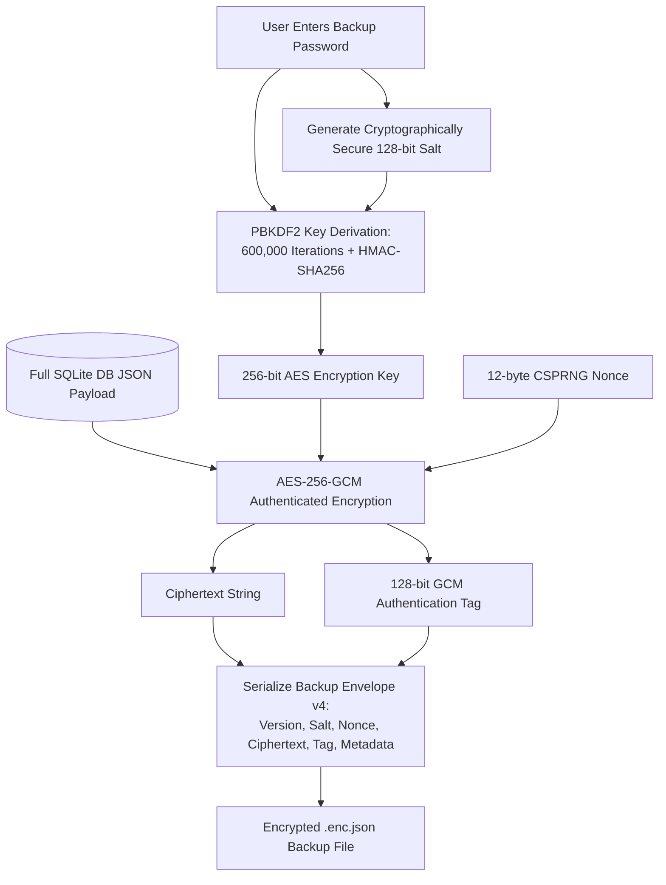

# Privacy & Security Model — व्यवहार (Vyavahaar)

> **Architecture Principle**: 100% Local-First & Zero-Knowledge  
> **Encryption Standard**: AES-256-GCM + PBKDF2-HMAC-SHA256 (600,000 iterations)  
> **Sole Application Framework**: Flutter + Dart  
> **Last Updated**: 2026-11-21  

---

## 1. Threat Model & Privacy Philosophy

In Indian culture, family gift ledgers contain sensitive information:
- Financial liquidity of the household.
- Personal phone numbers and addresses of relatives.
- History of personal relationships and family gift reciprocation.

### Zero-Tracking & Local Data Ownership
- **No Remote Servers**: The application has no server backend, no database in the cloud, and no telemetry services.
- **No Analytics / Ad SDKs**: There are zero advertising trackers, Google Analytics, Firebase tracking, or third-party profiling SDKs embedded in the app.
- **No User Account Requirement**: Users do not need an email, phone number, or OTP to access or operate the app.
- **Physical Device Boundary**: The SQLite database `vyavahaar.db` is stored strictly in the app's sandboxed private storage directory, inaccessible to other apps without root permissions.

---

## 2. Platform Permissions Audit

The application enforces the **Principle of Least Privilege**:

| Permission | Status | Purpose |
| :--- | :--- | :--- |
| `android.permission.INTERNET` | **NOT REQUIRED / NOT USED** | Core app operates entirely offline. |
| `android.permission.ACCESS_NETWORK_STATE` | **NOT USED** | App does not check online status. |
| `android.permission.READ_EXTERNAL_STORAGE` | **SCOPED STORAGE** | Scoped file sharing via `share_plus` / `path_provider`. |
| `android.permission.WRITE_EXTERNAL_STORAGE`| **NOT REQUESTED** | Files saved only to app-private cache or shared via system sheet. |

---

## 3. Cryptographic Specifications for Offline Backups

When users export or share an encrypted backup file, the data is secured using authenticated AES-256-GCM encryption via the Dart `cryptography` package:

### Key Parameters:
1. **Key Derivation**: PBKDF2 (Password-Based Key Derivation Function 2) with HMAC-SHA256.
2. **Iteration Count**: **600,000 iterations** adhering to OWASP recommendations.
3. **Random Salt & Nonce**: 128-bit salt and 96-bit (12-byte) nonce generated uniquely per operation using `Random.secure()`.
4. **Integrity & Authenticity**: 128-bit GCM authentication tag verifies ciphertext and parameters before decryption.
5. **Zero Password Storage**: The user's backup password is never written to disk, cached, or saved in SQLite.

---

## 4. Safe Restore Integrity & Rollback

Restoring a database replaces the active SQLite file. To prevent accidental data loss:
1. **Pre-Restore Validation**: File parsing, decompression, and cryptographic authentication happen in memory before modifying the database.
2. **Atomic SQLite Transaction**: The replacement executes inside a single database transaction (`db.transaction()`).
3. **Automatic Rollback**: If an exception occurs during decryption, JSON parsing, or row insertion, the transaction rolls back cleanly with zero partial records.
4. **Incorrect Password Protection**: If an incorrect password is provided, decryption fails in memory, leaving active database data untouched.
