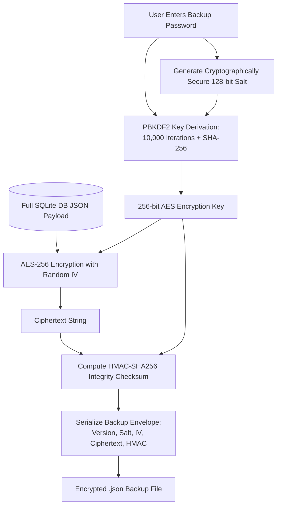

# Privacy & Security Model — व्यवहार (Vyavahaar)

> **Architecture Principle**: 100% Local-First & Zero-Knowledge  
> **Encryption Standard**: AES-256-GCM + PBKDF2 Key Derivation  
> **Last Updated**: 2026-11-21

---

## 1. Threat Model & Privacy Philosophy

In Indian culture, family gift ledgers contain sensitive information:
- Financial liquidity of the household.
- Personal phone numbers and addresses of relatives.
- History of personal relationships and family gift reciprocation.

### Zero-Tracking & Local Data Ownership
- **No Remote Servers**: The application has no server backend, no database in the cloud, and no telemetry services.
- **No Analytics / Ad SDKs**: There are zero advertising trackers, Google Analytics, Firebase tracking, or third-party profiling SDKs embedded in the app.
- **No User Account Requirement**: Users do not need an email, phone number, or OTP to access or operate the app.
- **Physical Device Boundary**: The SQLite database `vyavahaar.db` is stored strictly in the app's sandboxed private storage directory (`/data/data/ai.antigem/...` or Android internal storage), inaccessible to other apps without root permissions.

---

## 2. Android Permissions Audit

The application enforces the **Principle of Least Privilege**:

| Permission | Status | Purpose |
| :--- | :--- | :--- |
| `android.permission.INTERNET` | **NOT REQUIRED / NOT USED** | Core app operates entirely offline. |
| `android.permission.ACCESS_NETWORK_STATE` | **NOT USED** | App does not check online status. |
| `android.permission.READ_EXTERNAL_STORAGE` | **SCOPED STORAGE** | Scoped file sharing via `expo-sharing` (Android 10+ compliant). |
| `android.permission.WRITE_EXTERNAL_STORAGE`| **NOT REQUESTED** | Files saved only to app-private cache or shared via SAF. |
| `android.permission.VIBRATE` | **ALLOWED** | Used by `expo-haptics` for tactile button press feedback. |

---

## 3. Cryptographic Specifications for Offline Backups

When users export or share an encrypted backup file, the data is secured using military-grade authenticated cryptography via `crypto-js`:

### Key Parameters:
1. **Key Derivation**: PBKDF2 (Password-Based Key Derivation Function 2) with SHA-256.
2. **Iteration Count**: `10,000` iterations to resist brute-force dictionary attacks.
3. **Random Salt & IV**: Generated uniquely for every single backup run using `CryptoJS.lib.WordArray.random(16)`.
4. **Integrity Verification**: HMAC-SHA256 signature guarantees that tampered or truncated backup files are detected and rejected before decryption.
5. **Zero Password Storage**: The user's backup password is never written to disk, cached, or saved in SQLite.

---

## 4. Safe Restore Integrity & Rollback

Restoring a database replaces the active SQLite file. To prevent accidental data loss:
1. **Pre-Restore Safety Snapshot**: An in-memory snapshot of all active tables is captured before touching SQLite.
2. **Atomic Transaction**: The replacement executes inside `withTransactionSync`.
3. **Automatic Rollback**: If an exception occurs during decryption, JSON parsing, or table insertion, the database is rolled back atomically to its pre-restore state.
4. **Incorrect Password Protection**: If an incorrect password is provided, decryption fails cleanly with a user-friendly error message, leaving active data completely untouched.
