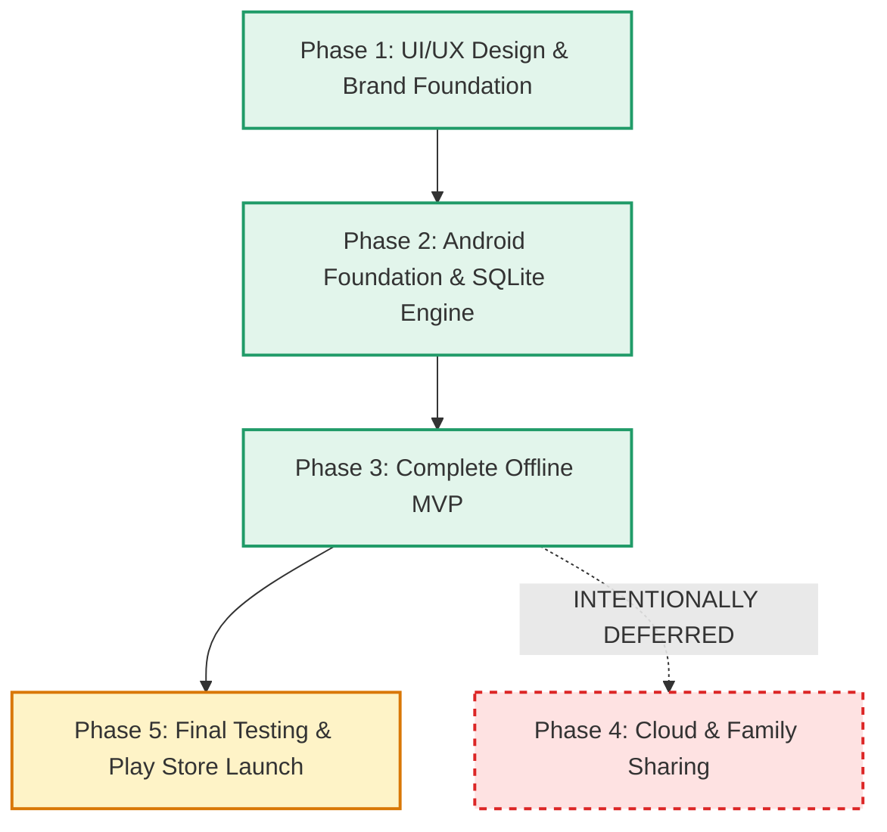

# Product Roadmap & Milestones — व्यवहार (Vyavahaar)

> **Current Phase**: Phase 3 Complete (Offline MVP) & Phase 5 Pre-Launch Audit  
> **Last Updated**: 2026-11-21

---

## 🗺️ Five-Phase Overview

---

## Phase Details & Execution Status

### Phase 1: UI/UX Design & Brand Foundation (`COMPLETE`)
- [x] Establish official brand palette (Deep Navy `#1F3352`, Terracotta `#C05A2B`, Warm Cream `#F4EFE7`).
- [x] Design app icon, splash screen, and Android adaptive icon assets.
- [x] Define Hindi typography and Devanagari font standards.
- [x] Create reusable UI component library (`VCard`, `VButton`, `AmountInput`, `DirectionBadge`).
- [x] Enforce **zero emoji rule** (pure `@expo/vector-icons` Ionicons only).

### Phase 2: Android Foundation & SQLite Engine (`COMPLETE`)
- [x] Expo SDK 58 + React Native 0.88 + TypeScript 5.9 environment setup.
- [x] Expo Router file-based tab navigation.
- [x] SQLite synchronous database integration with WAL mode and foreign keys.
- [x] Core data models: Households, Families, People, Events, Entries, Entry Items, Reminders.
- [x] Integer paise currency architecture (e.g. ₹1,100 = 110000 paise).
- [x] Strict separation of Mila and Diya amounts.
- [x] Business logic test suite (`scripts/test-business-logic.ts` — 16 tests passing).

### Phase 3: Complete Offline MVP (`COMPLETE`)
- [x] **Advanced Search & Multi-Filters**: Filter by person, village, event, direction, date range.
- [x] **Past & Planned व्यवहार**: Schema migration v3 adding `status` (`'planned' | 'recorded' | 'cancelled'`) and `expected_date`.
- [x] **Devanagari Hindi PDF Export**: 6 printable A4 reports with embedded Noto Sans Devanagari font.
- [x] **Excel-Compatible CSV Export**: RFC-4180 CSV with UTF-8 BOM (`\uFEFF`).
- [x] **Encrypted Offline Backup**: AES-256-GCM + PBKDF2 (10,000 iterations) with HMAC verification.
- [x] **Safe Restore & Atomic Rollback**: Safety snapshot before restore with automatic rollback on error.
- [x] **Scale Stress Test**: Verified 31,500 records query performance under 26ms.
- [x] **Home Screen Redesign**: Compact header, financial cards, stats bar, and primary quick actions.
- [x] **Floating Pill Tab Bar**: Expanding chip design with hardened touch and navigation handlers.

### Phase 4: Cloud & Family Sharing (`STRICTLY DEFERRED`)
> [!IMPORTANT]
> **PHASE 4 IS INTENTIONALLY DEFERRED AND FROZEN.**
> 
> The application must remain 100% offline-first and private. Do NOT implement:
> - Supabase or cloud databases.
> - User accounts or OTP authentication.
> - Cloud backups or remote servers.
> - Multi-device online synchronization.
> 
> *Rationale*: User family ledgers are private cultural records. Offline-first guarantees total privacy, zero server hosting costs, and zero network downtime during celebrations.

### Phase 5: Final Testing & Play Store Launch (`IN PROGRESS`)
- [x] Complete automated regression testing (27/27 tests passed).
- [x] TypeScript compiler verification (0 errors).
- [x] Production asset generation (adaptive icons, splash screen, notification icons).
- [x] Memory & query scale stress testing.
- [ ] Android package name alignment (`com.vyavahaar.app`).
- [ ] Production Android App Bundle (`.aab`) generation via EAS or local Gradle.
- [ ] Google Play Store privacy policy and Data Safety declaration.
- [ ] Closed internal testing track rollout.

### Phase 6: Multi-Platform Desktop & iOS Expansion (`APPROVED ARCHITECTURE`)
- [x] 5-Platform Architecture Blueprint documented (`docs/FLUTTER_MIGRATION_ARCHITECTURE.md`).
- [x] Packaging and release specifications documented (`docs/PLATFORM_RELEASE.md`).
- [ ] iOS target verification and App Store configuration.
- [ ] Linux Desktop packaging (AppImage / Flatpak).
- [ ] macOS Desktop packaging (DMG / Universal Binary).
- [ ] Windows Desktop packaging (MSIX / Win32 installer).
