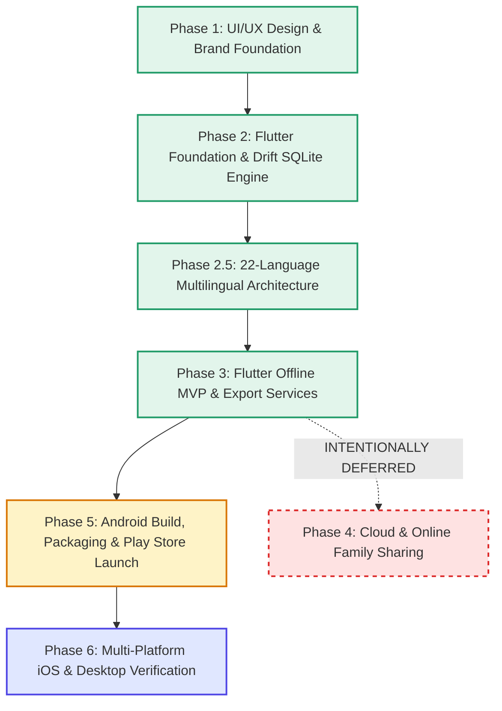

# Product Roadmap & Milestones — व्यवहार (Vyavahaar)

> **Current Phase**: Flutter Migration Complete on `migration/flutter-only` • Phase 5 Android Release Prep  
> **Sole Application Framework**: Flutter + Dart  
> **Last Updated**: 2026-11-21  

---

## 🗺️ Six-Phase Overview

---

## Phase Details & Execution Status

### Phase 1: UI/UX Design & Brand Foundation (`COMPLETE`)
- [x] Establish official brand palette (Deep Navy `#1F3352`, Terracotta `#C05A2B`, Warm Cream `#F4EFE7`, Forest Green `#2E7D32`).
- [x] Design brand identity, icons, and splash screen assets.
- [x] Define Hindi typography and Devanagari font standards.
- [x] Create reusable UI layout components (`ResponsiveLayout`, `FloatingPillTabBar`, `DirectionBadge`).
- [x] Enforce **zero emoji rule** (pure vector icons from Material Icons exclusively).

### Phase 2: Flutter Foundation & Drift SQLite Engine (`COMPLETE`)
- [x] Flutter SDK stable + Dart 3.x project foundation setup.
- [x] Drift typed SQLite ORM layer with WAL mode and foreign key enforcement.
- [x] Relational schema v4: Households, Families, People, Events, Entries, Entry Items, Reminders, AppSettings.
- [x] Integer paise currency architecture (e.g. ₹1,100 = 110,000 paise).
- [x] Strict isolation of Mila (Received) and Diya (Given) amounts.
- [x] Separation of physical gift estimates from cash totals.
- [x] SQLite database stress testing (`scripts/test-database-architecture.py` — 14/14 tests passing).

### Phase 2.5: Indian Multilingual Localization Architecture (`COMPLETE`)
- [x] Central `LanguageRegistry` covering all 22 Scheduled Indian Languages + English.
- [x] Extensible language API (`registerLanguage()`) for regional dialects.
- [x] Flutter ARB catalogs (`app_en.arb`, `app_hi.arb`, `app_ur.arb`) with ICU pluralization.
- [x] Right-to-Left (RTL) engine for Urdu, Kashmiri, and Sindhi scripts.
- [x] Unicode NFC search normalization across 12 Indic scripts (`scripts/test-multilingual-architecture.py` — 22/22 tests passing).
- [x] Runtime `LanguageSelectorScreen` with native names and zero country flags.

### Phase 3: Flutter Offline Feature Migration & Export Services (`COMPLETE`)
- [x] **Home Dashboard**: Modern compact header, separate financial cards, quick actions.
- [x] **Bahi Khata (Ledger)**: Real-time search, Mila/Diya direction filters, large rupee cards.
- [x] **People Directory & Detail**: Relatives contact book and chronological exchange history.
- [x] **Events Management**: Ceremonial event creation, ceremony summary totals, guest lists.
- [x] **Transaction Recording**: Multi-item entries, planned/recorded toggles, soft archiving.
- [x] **Reminders (अनुस्मारक)**: Upcoming ceremony and planned transaction tracking.
- [x] **A4 Devanagari PDF Export**: High-resolution offline vector PDF reports via `pdf` & `printing`.
- [x] **Excel-Compatible CSV Export**: RFC-4180 CSV serializer with UTF-8 BOM (`\uFEFF`) via `csv`.
- [x] **AES-256-GCM Encrypted Backup**: Authenticated offline backup with OWASP PBKDF2 (600,000 iterations).
- [x] **Safe Restore & Atomic Rollback**: Pre-restore validation and rollback on error.
- [x] **Legacy Runtime Removal**: Complete deletion of obsolete Expo, React Native, and Metro tooling.

### Phase 4: Cloud & Family Sharing (`STRICTLY DEFERRED`)
> [!IMPORTANT]
> **PHASE 4 IS INTENTIONALLY DEFERRED AND FROZEN.**
> 
> The application must remain 100% offline-first and private. Do NOT implement:
> - Supabase, Firebase, or cloud databases.
> - User accounts, passwords, or OTP authentication.
> - Cloud backups or remote analytics servers.
> - Multi-device online synchronization.
> 
> *Rationale*: User family ledgers are private cultural records. Offline-first guarantees total privacy, zero server hosting costs, and zero network downtime during celebrations.

### Phase 5: Android Build, Packaging & Play Store Launch (`IN PROGRESS`)
- [x] Clean Flutter architecture with 0 legacy JavaScript dependencies.
- [x] Automated CI workflow covering Python architecture tests, code generation, and Flutter tests.
- [x] Android package name alignment (`com.vyavahaar.app`).
- [x] Google Play Store privacy policy and Data Safety declaration (`docs/PRIVACY_POLICY.md`).
- [ ] Production Android App Bundle (`.aab`) generation via Flutter Gradle.
- [ ] Closed internal testing track rollout.

### Phase 6: Multi-Platform iOS & Desktop Verification (`FUTURE MILESTONES`)
- [x] Unified Flutter codebase supporting Android, iOS, Linux, macOS, and Windows.
- [x] Multi-platform packaging and release specifications documented (`docs/PLATFORM_RELEASE.md`).
- [ ] **Milestone 6.1 (iOS)**: Xcode project configuration, iOS signing, and TestFlight build.
- [ ] **Milestone 6.2 (Linux Desktop)**: AppImage / Flatpak packaging with native SQLite.
- [ ] **Milestone 6.3 (macOS Desktop)**: DMG / Universal Binary signing and notarization.
- [ ] **Milestone 6.4 (Windows Desktop)**: MSIX / Win32 installer packaging with native SQLite.
