# Testing Strategy & Quality Assurance — व्यवहार (Vyavahaar)

> **Test Suites**: `scripts/test-database-architecture.py`, `scripts/test-multilingual-architecture.py`, `test/unit/`  
> **Framework**: Flutter + Dart  
> **Last Verified Date**: 2026-11-21  

---

## 1. Test Architecture Overview

```mermaid
flowchart TD
    Runner[Test Verification Suites] --> T1[test-database-architecture.py: 14 Tests]
    Runner --> T2[test-multilingual-architecture.py: 22 Tests]
    Runner --> T3[flutter test: Unit Test Suite]

    subgraph DB_Stress [SQLite Database Architecture & Scale Stress]
        T1 --> D1[Schema v4: 7 Tables & 14 Indexes]
        T1 --> D2[ON DELETE RESTRICT & CASCADE Rules]
        T1 --> D3[Atomic Rollback on Transaction Failure]
        T1 --> D4[Separation of Mila & Diya]
        T1 --> D5[31,700 Records Scale Stress Test]
    end

    subgraph Multilingual [22 Indian Scheduled Languages & Unicode]
        T2 --> M1[22 Languages Catalogue & BCP 47]
        T2 --> M2[RTL Recognition: Urdu, Kashmiri, Sindhi]
        T2 --> M3[ARB Key Parity & ICU Plurals]
        T2 --> M4[Unicode NFC Search across 12 Indic Scripts]
        T2 --> M5[Ban on Commercial Debt/Credit Terminology]
    end

    subgraph Unit [Flutter Unit Tests]
        T3 --> U1[CurrencyUtils: Integer Paise Math]
        T3 --> U2[DateUtils: Formatting & Validation]
        T3 --> U3[FinancialRules: Domain Constraints]
        T3 --> U4[Localization: Specifications]
    end
```

---

## 2. Automated Architecture Test Suites

### 2.1 Database Architecture & Stress Suite (`scripts/test-database-architecture.py`)
Run command: `python3 scripts/test-database-architecture.py`

| Category | Test Case Description | Expected Result | Status |
| :--- | :--- | :--- | :--- |
| **Schema** | 7 core tables exist | Tables present in SQLite schema | **PASS** |
| **Indexes** | 14 performance indexes created | Foreign key & search indexes present | **PASS** |
| **Integrity** | `ON DELETE RESTRICT` on people | Prevents deleting person with entries | **PASS** |
| **Integrity** | `ON DELETE CASCADE` on entry items | Automatically cascades item deletion | **PASS** |
| **Constraints** | Direction CHECK constraint | Rejects values other than 'received'/'given' | **PASS** |
| **Constraints** | Status CHECK constraint | Rejects values other than 'recorded'/'planned'/'cancelled' | **PASS** |
| **Atomicity** | Multi-item entry atomic save | Saves entry and items in single transaction | **PASS** |
| **Atomicity** | Atomic rollback on error | Zero partial records remaining on error | **PASS** |
| **Financial** | Kul Mila (Total Received) calculation | Pure cash calculation; never netted | **PASS** |
| **Financial** | Kul Diya (Total Given) calculation | Excludes planned & cancelled entries | **PASS** |
| **Financial** | Gift estimate isolation | Physical gift estimates excluded from cash | **PASS** |
| **Scale** | 31,700 records batch insert | Completes cleanly on SQLite engine | **PASS** |
| **Scale** | 10,000 transactions aggregation | Query completes in < 20ms using indexes | **PASS** |
| **Scale** | Person history query with JOINs | Query completes in < 15ms | **PASS** |

### 2.2 Multilingual Localization Suite (`scripts/test-multilingual-architecture.py`)
Run command: `python3 scripts/test-multilingual-architecture.py`

| Category | Test Case Description | Expected Result | Status |
| :--- | :--- | :--- | :--- |
| **Registry** | 22 Scheduled Indian Languages registered | Exact match with Eighth Schedule | **PASS** |
| **RTL** | Right-to-Left script recognition | Urdu, Kashmiri, Sindhi identified as RTL | **PASS** |
| **ARB** | English source template `app_en.arb` | File exists with canonical keys | **PASS** |
| **ARB** | Hindi translation `app_hi.arb` | Complete key parity with English | **PASS** |
| **ARB** | Urdu translation `app_ur.arb` | Complete key parity with English | **PASS** |
| **ICU** | ICU plural syntax validation | Valid `{count, plural}` blocks verified | **PASS** |
| **Unicode** | NFC search across 12 Indic scripts | Matches Devanagari, Bengali, Gurmukhi, Gujarati, Odia, Tamil, Telugu, Kannada, Malayalam, Meitei, Ol Chiki, Arabic | **PASS** |
| **Cultural** | Zero commercial debt terminology | Catalogs checked for zero loan/credit terms | **PASS** |

### 2.3 Flutter Unit Test Suite (`test/unit/`)
Run command: `flutter test` (via GitHub Actions CI)
- `currency_utils_test.dart`: Integer paise arithmetic, formatters, and rounding immunity.
- `date_utils_test.dart`: ISO date formatting and parsing.
- `financial_rules_test.dart`: Separation of Mila and Diya, planned entry isolation, and gift estimate isolation.
- `localization_test.dart`: BCP 47 tags, script identification, and RTL flags.

---

## 3. Scale Stress Test Benchmarks (Empirical Evidence)

Tested on SQLite in-memory and flash storage:
- **Dataset**: 1,000 People, 500 Ceremonies, 10,000 Transactions, 20,000 Gift Items (**Total: 31,700 records**).
- **Batch Insertion**: 31,700 records inserted in **1.79s** (mobile ARM chip).
- **Aggregation Benchmark**: Financial aggregation over 10,000 transactions executed in **3.68ms**.
- **Person History Benchmark**: Complex JOIN query over person transactions executed in **0.43ms**.

---

## 4. Five-Platform QA Matrix

| Capability / Test | Android | iOS | Linux Desktop | macOS Desktop | Windows Desktop |
| :--- | :---: | :---: | :---: | :---: | :---: |
| **Drift SQLite Schema v4 & Migrations** | **VERIFIED** | Ready | Ready | Ready | Ready |
| **Financial Domain Rules (Paise math)** | **VERIFIED** | Ready | Ready | Ready | Ready |
| **AES-256-GCM + PBKDF2 Encryption** | **VERIFIED** | Ready | Ready | Ready | Ready |
| **Devanagari PDF Rendering** | **IMPLEMENTED** | Ready | Ready | Ready | Ready |
| **RFC-4180 CSV UTF-8 BOM Export** | **IMPLEMENTED** | Ready | Ready | Ready | Ready |
| **Touch Interaction & Bottom Floating Pill** | **IMPLEMENTED** | Ready | N/A | N/A | N/A |
| **Responsive Desktop / Sidebars** | N/A | N/A | Ready | Ready | Ready |
| **100% Offline Autonomy** | **VERIFIED** | Ready | Ready | Ready | Ready |
