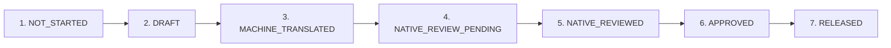

# Multilingual Translation Workflow & Quality Assurance — व्यवहार (Vyavahaar)

> **Core Standard**: Zero hardcoded strings; strict ICU message formatting; mandatory native human review for financial terms.  
> **Last Updated**: 2026-11-21  

---

## 1. Translation Life Cycle Stages

Every language catalog progresses through 7 strictly audited states:

1. **NOT_STARTED**: Language is registered in `LanguageRegistry`, but no `.arb` file exists yet.
2. **DRAFT**: Initial string catalog created with key definitions.
3. **MACHINE_TRANSLATED**: Initial AI/tooling draft applied for testing layout and line height.
4. **NATIVE_REVIEW_PENDING**: Translation submitted to a certified or native speaker.
5. **NATIVE_REVIEWED**: Native speaker has verified cultural nuance, grammar, and formal Indian social ledger terms.
6. **APPROVED**: Lead localization engineer and QA have tested font rendering and RTL alignment.
7. **RELEASED**: Enabled as production option in the application release.

---

## 2. Key Naming Conventions

All translation keys must follow strict **camelCase** semantic naming:

- **Entity Labels**: `people`, `families`, `events`, `transactions`.
- **Action Buttons**: `addPerson`, `addEvent`, `addTransaction`, `save`, `cancel`, `confirm`, `delete`.
- **Financial Statuses**: `planned`, `recorded`, `cancelled`.
- **Financial Balances**: `totalReceived`, `totalGiven`.
- **Validation Messages**: `validationRequired`, `validationPositiveAmount`.
- **Plurals**: `entryCount`, `personCount`, using ICU `{count, plural, =0{...} =1{...} other{...}}`.

### Strict Rules:
- **Never concatenate translated fragments** (e.g. `"Total " + "Given"`). Always provide the full sentence key.
- **Never embed numerical IDs in keys** (e.g. `label_1`, `text_button_2`).
- **Never hardcode English or Hindi fallback in widget files**. Always call `AppLocalizations.of(context)!.key`.

---

## 3. Cultural Terminology Guide

| English Technical Concept | Hindi Approved | Bengali Approved | Urdu Approved | Tamil Approved | Telugu Approved | Strict Warning |
| :--- | :--- | :--- | :--- | :--- | :--- | :--- |
| **Received** | मिला | প্রাপ্ত | ملا | பெறப்பட்டது | అందింది | Never use "Credit" / जमा |
| **Given** | दिया | প্রদত্ত | دیا | வழங்கப்பட்டது | ఇవ్వబడింది | Never use "Debit" / खर्च |
| **Ledger / History**| बही-खाता | হিসাবের খাতা | بہی کھاتہ | குடும்பக் கணக்கு | లెక్కల పుస్తకం | Never use "Loan" / कर्ज |
| **Planned** | योजना | পরিকল্পিত | منصوبہ بند | திட்டமிடப்பட்டது | ప్రణాళిక | Never use "Due" / बकाया |
| **Gift / Items** | भेंट / सामान | উপহার / দ্রব্য | تحفہ / اشیاء | அன்பளிப்பு | కానుకలు | Keep separate from cash |

---

## 4. Adding a New Language

To register an additional regional language or dialect (e.g. Bhojpuri, Rajasthani, Tulu):
1. Add language metadata to `lib/src/core/localization/language_registry.dart` via `LanguageRegistry.instance.registerLanguage()`.
2. Add the font family specification to `docs/FONT_AND_SCRIPT_SUPPORT.md`.
3. Create `lib/l10n/app_<lang>.arb` mirroring all keys in `lib/l10n/app_en.arb`.
4. Run localization validation tests in `scripts/test-multilingual-architecture.py`.
