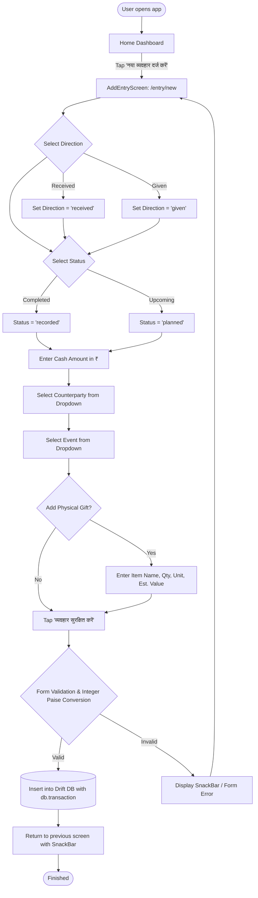
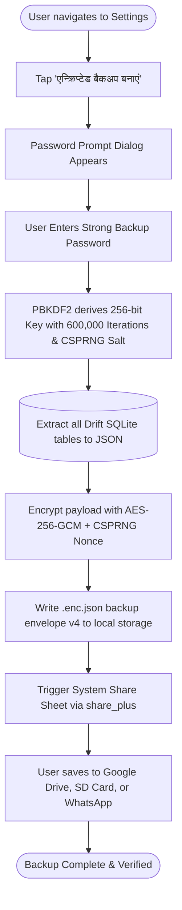
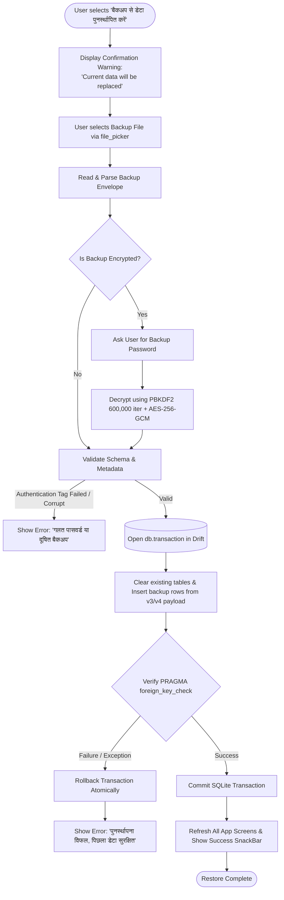

# User Flows & Journeys — व्यवहार (Vyavahaar)

> **Visual Language**: Mermaid Flowcharts & State Diagrams  
> **Sole Application Framework**: Flutter + Dart  
> **Last Updated**: 2026-11-21  

---

## 0. Application Launch & First-Time Onboarding Journey (ऐप लॉन्च और ऑनबोर्डिंग)

```mermaid
flowchart TD
    Launch([User launches Vyavahaar]) --> Splash[SplashScreen: /splash]
    Splash --> Animate[Play 1200ms Brand Logo Fade & Scale Animation]
    Animate --> CheckSetting{Query SQLite SettingsDao:\n'onboarding_completed' == 'true'?}
    
    CheckSetting -->|No / First Launch| Onboarding[OnboardingScreen: /onboarding]
    CheckSetting -->|Yes / Returning User| Dashboard[Home Dashboard: /]
    
    subgraph OnboardingFlow [Onboarding Walkthrough]
        Onboarding --> Slide1["Slide 1: पारंपरिक बही-खाता\n(Mila & Diya Separation, Cash vs Gifts)"]
        Slide1 -->|Tap Next / Swipe| Slide2["Slide 2: रिश्तों का सम्मान\n(Zero Debt Mindset, Pre-event Planning)"]
        Slide2 -->|Tap Next / Swipe| Slide3["Slide 3: पूर्णतः ऑफ़लाइन व निजी\n(AES-256 Encryption, Language Selector)"]
        Slide1 -->|Tap 'छोड़ें' (Skip)| CompleteTour[Save 'onboarding_completed' = 'true' in DB]
        Slide2 -->|Tap 'छोड़ें' (Skip)| CompleteTour
        Slide3 -->|Tap 'शुरू करें' (Get Started)| CompleteTour
    end
    
    CompleteTour --> Dashboard
    
    subgraph RevisitTour [Revisiting Onboarding Anytime]
        SettingsTab[Settings Screen] -->|Tap 'ऐप परिचय (ऑनबोर्डिंग)'| OnboardingTour[OnboardingScreen: /onboarding?fromSettings=true]
        OnboardingTour -->|Tap Finish / Pop| SettingsTab
    end
```

---

## 1. Recording a New Transaction (नया व्यवहार दर्ज करना)



---

## 2. Checking a Relative's Relationship History (रिश्तेदार का इतिहास देखना)

```mermaid
flowchart TD
    Start([User receives ceremony invitation]) --> NavPeople[Navigate to 'लोग' Tab]
    NavPeople --> Search[Type Relative Name or Village in Search Bar]
    Search --> SelectPerson[Tap on Relative Card from Results]
    SelectPerson --> Profile[PersonDetailScreen: /person/:id]
    Profile --> ViewSummary[View Separated Totals:\nकुल मिला: ₹X | कुल दिया: ₹Y]
    Profile --> ViewTimeline[Scroll Chronological Timeline of Past Functions]
    ViewTimeline --> Action{User Decision}
    Action -->|Call Relative| Dial[Tap Phone Number]
    Action -->|Export PDF| PDF[Generate Person-wise Hindi PDF Report]
    Action -->|Plan Return Gift| Plan[Tap 'व्यवहार दर्ज करें' with Person pre-selected]
```

---

## 3. Encrypted Local Backup Workflow (सुरक्षित एन्क्रिप्टेड बैकअप)



---

## 4. Safe Restore Workflow with Automatic Rollback (डेटा पुनर्स्थापना)


