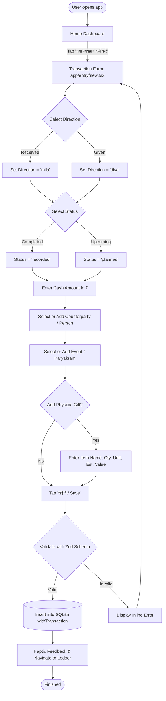
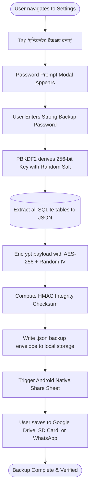
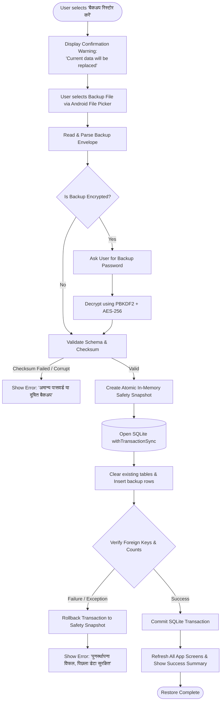

# User Flows & Journeys — व्यवहार (Vyavahaar)

> **Visual Language**: Mermaid Flowcharts & State Diagrams  
> **Last Updated**: 2026-11-21

---

## 1. Recording a New Transaction (नया व्यवहार दर्ज करना)



---

## 2. Checking a Relative's Relationship History (रिश्तेदार का इतिहास देखना)

```mermaid
flowchart TD
    Start([User receives wedding invitation]) --> NavPeople[Navigate to 'लोग' Tab]
    NavPeople --> Search[Type Relative Name or Village in Search Bar]
    Search --> SelectPerson[Tap on Relative Card from Results]
    SelectPerson --> Profile[Person Profile: app/person/[id].tsx]
    Profile --> ViewSummary[View Separated Totals:\nकुल मिला: ₹X | कुल दिया: ₹Y]
    Profile --> ViewTimeline[Scroll Chronological Timeline of Past Functions]
    ViewTimeline --> Action{User Decision}
    Action -->|Call Relative| Dial[Tap Phone Number to open Android Dialer]
    Action -->|Export PDF| PDF[Generate Person-wise Hindi PDF Report]
    Action -->|Plan Return Gift| Plan[Tap 'नया व्यवहार' with Person pre-selected]
```

---

## 3. Encrypted Local Backup Workflow (सुरक्षित एन्क्रिप्टेड बैकअप)



---

## 4. Safe Restore Workflow with Automatic Rollback (डेटा पुनर्स्थापना)


